# MultiGo Neo — Feature Register

**Version:** 1.1.28 · **Updated:** 2026-11-28 · **Repository:** [lots/my-MultiGoNeo](https://github.com/lots/my-MultiGoNeo) · **Latest release:** [v1.1.28](https://github.com/lots/my-MultiGoNeo/releases/tag/v1.1.28)

This document tabulates every direct feature request captured during the project's working
sessions, what was delivered, and when it first shipped. A second section lists the notable
features that were built along the way but were not explicit requests. Feature details and the
full manual live in [README.md](README.md).

**Status key:** ✅ released · 🧪 verified in source and covered by a check · 📦 packaged in the
installer, portable build and web zip.

> **Latest (1.1.28): View rotation/flip controls.** The View toolbar now includes Rotate Clockwise,
> Flip H, Flip V and Reset Board alongside Zoom Out/In and Full Screen, and the View Toolbar
> checklist exposes all seven. The 1.1.27 Play/View toolbar work and earlier features remain.

---

## 1. Requested features

| # | Request | What was delivered | Status | First shipped |
|---|---------|--------------------|--------|---------------|
| 1 | Build **MultiGo Neo** from the Fig test tree into a public GitHub repository, standalone and installable on Windows 10/11, fully offline. | Electron 37 desktop app, NSIS per-user installer, single-file portable build, public repo, no runtime network access. | ✅📦 | 1.0.0 |
| 2 | Keep the **captured-stone bowls next to the goban**, including after the display area is resized. | Bowls are in-flow siblings of the board, not pinned to pane edges; gap measured at 8 px before and after resizing to 1200 px. | ✅🧪 | 1.1.3 |
| 3 | Give the captured stones on the bowl covers **3D effects** so they look realistic. | Top-down stacked stones with radial gradient shading, specular highlight and drop shadow; both colours stay legible on light kaya wood. | ✅🧪 | 1.1.3 |
| 4 | **"Count territory" was not working**; implement Sabaki's **Play → Estimate** and **Play → Score** instead. | Docked Score tab with Japanese/Chinese/Area/Territory accounting, dead-stone toggling, shading, dame dots, totals and **Write RE**; Estimate pre-marks sealed dead stones, Score starts clean. | ✅🧪 | 1.1.3 (reworked 1.1.4) |
| 5 | Fix **8×8 and smaller boards** clipping the stones at the board edge. | Board margin grows with the stone radius and coordinate label; verified 2×2, 4×4 and 8×8 with 14–17 px stone clearance and 8 px label clearance. | ✅🧪 | 1.1.3 |
| 6 | **Drop the "Count Territory" command** and keep only **Play → Estimate / Play → Score**. | Removed the Tools item, its menu action, `Ctrl+K`, and its strings; the two Play modes are the only scoring entry points. | ✅ | 1.1.4 |
| 7 | Provide a **portable web copy for a USB stick**: copy the folder, open the root `index.html` on another PC. | `web-portable/` with `index.html` at the root, every asset relative, a `README.txt` and a Windows launcher; runs from `file://` with no server or network. | ✅🧪📦 | 1.1.6 |
| 8 | **Bundle the SGF study records** from `AQ\sgf\十三路打谱操` into the installer and web build under `sgf\十三路打谱操`, refreshed on every build. | Installer uses `extraFiles`; web builder copies the folder; 17 SGFs verified in setup, portable and web zip. Rebuild refreshes added/changed/deleted records. | ✅🧪📦 | 1.1.6 |
| 9 | **Enlarge/restore the goban coordinate font** by clicking the coordinate margin, toggling between the current size and **double**. | Clicking a letter/number or the margin outside the stones doubles labels (11 → 22 px on 13×13); clicking again restores them. The board margin grows to fit and shrinks back; the choice persists; intersections still play moves. | ✅🧪📦 | 1.1.11 |
| 10 | **Version bump (z), update releases and distribution, publish** — repeated through the project. | Patch releases 1.1.5 → 1.1.11 with rebuilt setup/portable/web assets, README notes and verified SHA-256 digests. | ✅📦 | ongoing |
| 11 | Two consecutive passes should **end the game and offer to count** it. | Pass/pass prompt offers **Count Result** or **Keep Playing**; accepting opens the scoring card. | ✅🧪 | 1.1.3 |
| 12 | Bowls must be **light wood matching the goban**, must not duplicate the count number, and black stones must stay visible. | Light kaya bowls, no number badge (status bar already shows `Captures: B n · W n`), shaded stones with highlights; dark theme uses the rosewood palette. | ✅🧪 | 1.1.3 |
| 13 | Clarify how the **installer handles different versions** of the same app. | Documented as one product identity: newer installers upgrade/replace older ones (same appId/registry keys), settings preserved; side-by-side requires portable copies or a separate appId. | ✅ docs | 1.1.11 |
| 14 | Include **README.md, Features.md and Tutorial.md** in the installation root folder of every distribution. | Both packagers copy the three documents to the root of the installer/portable app and of the web folder/zip. | ✅📦 | 1.1.12 |
| 15 | Reduce the **empty space above and below the grey menu labels**. | Menu bar height reduced from 49 px to **36 px**; 18 px labels keep 6 px above/below, and a wrapped two-row bar is 72 px. Popups and responsive sizes unchanged. | ✅🧪 | 1.1.15 |
| 16 | Offer a **Scrolling mode** for the menu and tool bars as an alternative to wrapping when the window is narrow. | View → Scroll Menu and Tool Bars keeps each bar on one row with a horizontal scrollbar; popups are fixed below the bar and the mode persists. | ✅🧪📦 | 1.1.16 |
| 17 | Provide **names for the multiple parts** of the right-hand panel beside the goban. | Sidebar heading names the column; parts are **Info tabs** (Info/Comment/Engine/Score), **Node Name**, **Variations**, **Game Tree**, **Messages**. Visible labels, tooltips and ARIA names match. | ✅🧪📦 | 1.1.17 |
| 18 | Allow **multiple running instances** of the Windows app and the web app. | Desktop drops the single-instance lock, so each launch/double-click is a separate process/window; File → New Window opens another window (new browser tab) with its own board/game/engine. | ✅🧪📦 | 1.1.18 |
| 19 | Allow each Sidebar part to be **hidden/shown** from the View menu. | Independent View checkboxes for Info Tabs, Node Name, Variations, Game Tree and Messages; hidden parts release their space, splitters reflow and portrait accordion skips them. Choices persist. | ✅🧪📦 | 1.1.19 |
| 20 | After **View → Swap Player Sides**, put the bottom player's bowl on their right-hand side and the top player's on their left. | Bowl columns are derived from the seat: Black at bottom → Black right / White left; White at bottom → White right / Black left. Horizontal board flips still mirror the columns. | ✅🧪📦 | 1.1.20 |
| 21 | Add a **Basic** theme that mimics MultiGo 4.4.4's initial look and feel as closely as possible. | Uses MultiGo's stock 50×50 board-default wood tile, black grid/labels, glass stone palette, white board surround and classic grey Windows chrome with Tahoma menus. Selecting Basic also opens **Comment** and hides Node Name, Variations and Messages. | ✅🧪📦 | 1.1.21 |
| 22 | Provide **lookup documentation** for every user-invokable function, and explain Flatten/Clear Node Markup and the duplicate Advanced menu. | `Reference.md`/`Reference.pdf` tabulates all menus, toolbar controls, shortcuts, dialogs and modes plus detailed Flatten and Clear notes and the MultiGo Advanced mapping; Help opens it. The duplicate Advanced menu was removed. | ✅🧪📦 | 1.1.22 |
| 23 | Restore **Advanced** and implement its feature set as far as possible; compare the MultiGo toolbar. | Advanced now has Switch Black/White, Hide All Stones, Delete All Comments, Delete SGF Properties, Set Move Number, Move Branch Up/Down, Hide Markers, White Move First, Copy/Paste SGF, Delete All After Current and Clear Node Markup. Reference adds a MultiGo toolbar coverage table with missing items marked. | ✅🧪📦 | 1.1.23 |
| 24 | Remove duplicate **Advanced** commands from other menus. | Edit/Tools duplicates were removed; Advanced is the single menu home, while global shortcuts still work. | ✅🧪📦 | 1.1.24 |
| 25 | Replicate MultiGo **Options → Customize → Toolbar** for Main/Edit/Option/Traverse, and keep icon assets in an editable folder. | Options opens a per-toolbar checklist; visibility persists and Reset All restores it. Icons are individual SVGs in `src/assets/icons/` with `npm run icons:build` regenerating the sprite. | ✅🧪📦 | 1.1.25 |
| 26 | Make **Customize Toolbar** an actual submenu with Main/Edit/Option/Traverse children. | **Options → Customize Toolbar** expands the four entries (click to open), matching the MultiGo path; the 1.1.25 checklists and Reset All are unchanged. | ✅🧪📦 | 1.1.26 |
| 27 | Add **Play Toolbar** and **View Toolbar** under Customize Toolbar. | Six groups now: Main, Edit, Option, Traverse, Play, View. Play has Auto Play/Pass/Delete/Estimate/Score; View has Zoom Out/In and Full Screen; Traverse keeps navigation only. | ✅🧪📦 | 1.1.27 |
| 28 | Put **Rotate / Flip / Reset** on the View toolbar and expose them in Customize Toolbar. | View toolbar has Zoom Out/In, Rotate CW, Flip H, Flip V, Reset Board and Full Screen; the View Toolbar checklist lists all seven and persists visibility. | ✅🧪📦 | 1.1.28 |
| 24 | Where a function duplicates an **Advanced** command elsewhere, keep Advanced and remove the duplicate. | Removed Edit → Cut All After/Shift Variation/Clear Node Markup/Copy SGF/Paste SGF and Tools → Copy SGF/Load SGF. Advanced retains Delete All After Current, Move Branch Up/Down, Clear Node Markup and Copy/Paste SGF. | ✅🧪📦 | 1.1.24 |

### 1.1 Request notes

**Captured-stone bowls (requests 2, 3, 12).** The bowls are laid out beside the board as flex
siblings, so they stay glued to it when the window or pane resizes. Captured stones are drawn
top-down inside the bowl with a 3D gradient, a white glint and a soft shadow. They update live
during play, and dead stones join the prisoner total while scoring.

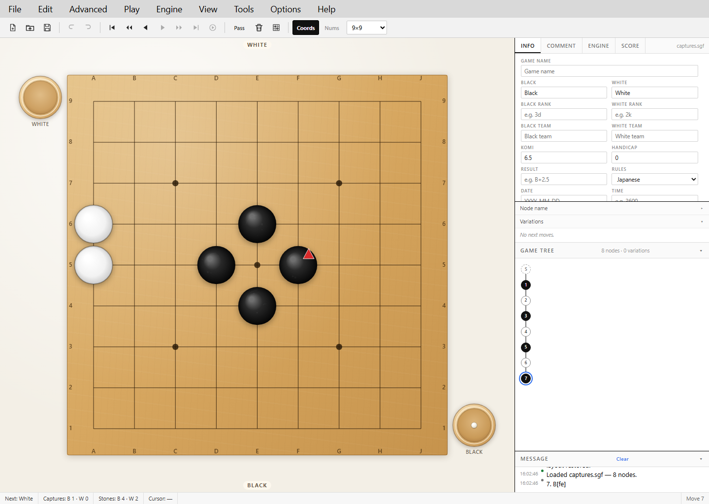

**Estimate and Score (request 4).** The old floating "Count Territory" card became the docked
**Score** tab. **Play → Estimate** runs a heuristic that marks sealed, eye-less chains dead;
**Play → Score** starts clean and waits for manual selection. Both share the rules switch,
shading, dame dots, totals, `Write RE` and the double-pass prompt.

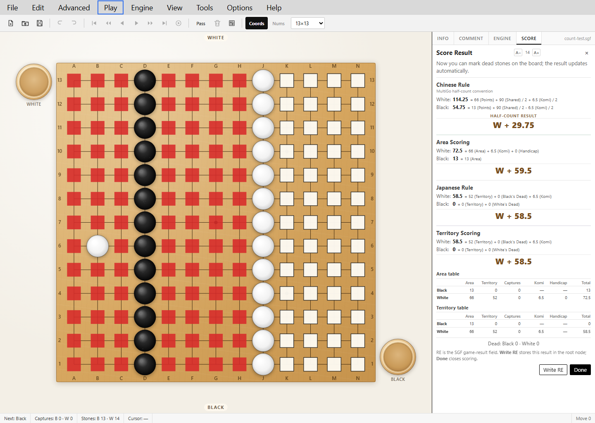

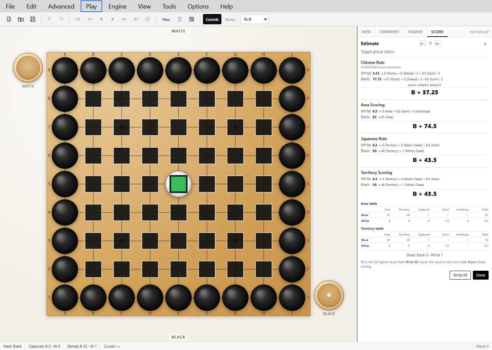

**Small boards (request 5).** The margin is grown until `stone radius + label + gap` fits, and
the label offset is chosen to stay outside the stones. This is the 8×8 case that used to clip:

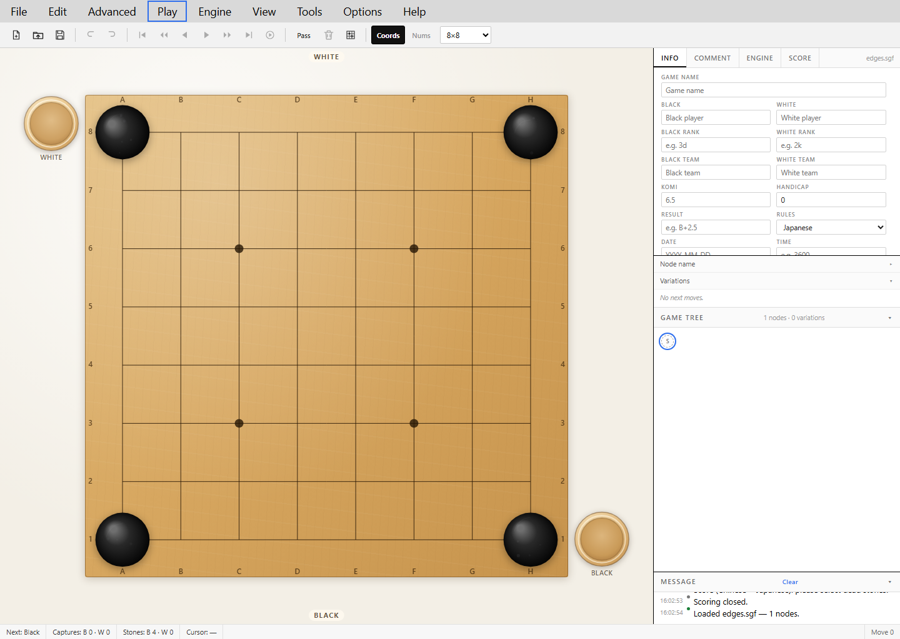

**Portable web and SGF records (requests 7, 8).** `npm run dist:web` builds the folder and the
matching `release/MultiGo-Neo-<version>-web.zip` from the same files, so the two cannot drift.
The 17 records are copied to `sgf/十三路打谱操` in the installer, portable and web builds.

**Coordinate labels (request 9).** Clicking the label ring toggles normal and double size; the
board margin grows for the larger labels. This build (1.1.11) is the first to contain it.

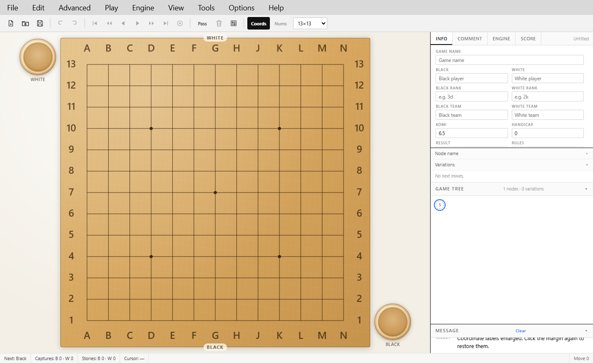

---

## 2. Interesting features

These were built as part of the product but were not separate requests. Each row links to the
detailed section in [README.md](README.md).

### 2.1 SGF editing and game tree

| Feature | What it does | Details |
|---|---|---|
| Lossless FF[4] SGF | Reads/writes FF[4], preserves unknown properties and comments; saves the whole tree. | [README § Game tree and SGF](README.md#game-tree-and-sgf) |
| Variation tree editor | Branches, sibling navigation, compact pass nodes, branch toggles, main-branch lane layout with wide columns and halo-separated crossings. | [README § Game tree and SGF](README.md#game-tree-and-sgf) |
| Editable node names | Edit the FF[4] `N` property with double-click, `F2` or Edit → Edit Node Name; names display beside nodes and round-trip through SGF. | [README § Version 1.1.7](README.md#version-117) |
| Node name / Variations panels | Collapsible strips above the tree; Variations lists immediate next moves with coordinates and branch names. | [README § Game tree and SGF](README.md#game-tree-and-sgf) |
| Comments and Markdown | Editable comments with Markdown rendering and adjustable comment font size (12–36 px). | [README § Supported comment Markdown](README.md#supported-comment-markdown) |
| Full markup toolset | Move/point marks, labels, dim/colour lines, arrows, territory and dim rectangles, coloured `AR`/`LN` lines and `SBKDD` dim colours. | [README § Modified FF[4]](README.md#modified-ff4) |
| Property log | Every move and non-move property edit is logged in the Message panel. | [README § Game tree and SGF](README.md#game-tree-and-sgf) |
| Read Only mode | Prevents editing while keeping navigation and the board usable. | [README § Read Only](README.md#read-only) |
| Reload and unsaved guard | Reload restores the exact branch/node; `UNSAVED` state, title bullet and confirmations protect changes. | [README § Unsaved changes](README.md#unsaved-changes) |
| Branch import and picture export | Import several SGFs as branches; export partial/full boards to PNG/JPEG with coordinates and sizing. | [README § Reload, imports and picture export](README.md#reload-imports-and-picture-export) |

### 2.2 Board and display

| Feature | What it does | Details |
|---|---|---|
| Four board themes | Classic, Flat, Dark and Paper, CSS-only; the dark theme recolours the board, stones and bowls. | [README § Board themes](README.md#board-themes-and-responsive-layout) |
| Rotation and flips | Display-only 90° rotations and horizontal/vertical flips with transformed hit testing; `G` resets. | [README § Board orientation](README.md#board-orientation) |
| Zoom | Scales the board canvas and spacing, independent of window size. | [README § Workspace](README.md#workspace) |
| Coordinate systems | **A1**, **1-1** and **CJK 四4** styles on all four sides; Coords toggle. | [README § Coordinate labels](README.md#coordinate-labels) |
| Coordinate font enlarge/restore | Click a label or the margin outside the stones to double the coordinate font; click again to restore. Margin grows/shrinks, preference persists, intersections still play. | [README § Coordinate labels](README.md#coordinate-labels) |
| Move numbers | None, all, last 10/25/50 or custom, numbered from game or variation start. | [README § Move numbers](README.md#move-numbers) |
| Variation badges and next moves | Lettered badges on candidate points, optional sibling/next-move hints, per-tool hover ghosts. | [README § Variation badges](README.md#variation-badges) |
| Focus and last-move markers | Triangle/dot focus marker in configurable colours; last move highlighted. | [README § View menu](README.md#view-menu) |
| Seat labels and bowls | BLACK/WHITE labels; bowls swap with View → Swap Player Sides; bowls hide in portrait. | [README § Estimate and Score](README.md#estimate-and-score) |
| Position links | A URL with `?sgf=…&path=…` reproduces the game and selected branch/node. | [README § Position links](README.md#position-links) |
| Embeddable viewer | Zero-JS `data-*` attributes render a board from an embedded SGF. | [README § Embeddable viewer](README.md#embeddable-viewer) |

#### 2.2.1 Coordinate font enlarge/restore (1.1.11)

The coordinate gutter is interactive in every coordinate style (**A1**, **1-1** and **CJK 四4**):

1. Make sure **Coords** is active in the toolbar.
2. Click a coordinate letter/number, or the margin outside the stones.
3. The labels switch to **double size** (for example 11 → 22 px on 13×13), the board margin grows
   so they stay inside the board and clear of edge stones, and the Message panel logs
   *"Coordinate labels enlarged. Click the margin again to restore them."*
4. Click again to **restore** the normal size; the margin shrinks back.

The choice is stored in settings and restored on the next launch. Clicking an intersection still
plays a move — the toggle only fires in the label margin. The interaction is covered by
`scripts/verify-coord-font-ui.mjs`.

### 2.3 Play, scoring and engines

| Feature | What it does | Details |
|---|---|---|
| Score tab | Chinese and Japanese totals side by side, plus standard Area and Territory Scoring and audit tables for area, territory, captures, komi, handicap and total. | [README § Estimate and Score](README.md#estimate-and-score) |
| Dead-stone marking | Click a chain to mark/revive it; green markers and red X; dead stones join prisoners. | [README § Estimate and Score](README.md#estimate-and-score) |
| Estimate heuristic | Pre-marks eye-less chains whose liberties become enemy-owned after lifting, with edge safety. | [README § Estimate and Score](README.md#estimate-and-score) |
| Pass/pass prompt | Two consecutive passes end the game and offer to score. | [README § Estimate and Score](README.md#estimate-and-score) |
| Capture sounds | Web Audio wooden click/bowl sound for captures, staggered for multiple stones. | [README § Version 1.1.4](README.md#version-114) |
| GTP engines | Attach GNU Go or KataGo, Generate Move, streaming analysis with win rate/candidates, board overlay, docked GTP console, Manage Engines JSON. | [README § GTP engines](README.md#gtp-engines) |

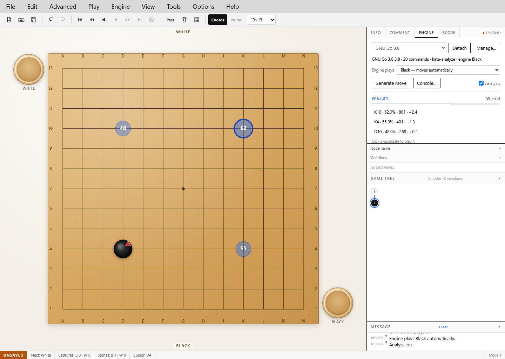

### 2.4 Workspace, UX and distribution

| Feature | What it does | Details |
|---|---|---|
| Docked workspace | Info, Comment, Engine and Score tabs; Game Tree and Message panes with resizable splitters. | [README § Workspace](README.md#workspace) |
| Collapsible panels | Game Tree and Message headers collapse their bodies; state remembered. | [README § Workspace](README.md#workspace) |
| Phone/portrait layout | Below 1120 px the board maximises, side panels become an accordion, and bowls hide; wrapping menu and tool bars. | [README § Version 1.1.9](README.md#version-119) |
| Bilingual UI | English and Chinese interface strings. | [README § Language and Options](README.md#language-and-options) |
| Recent files | Seven-entry recent list with in-memory content and reopen. | [README § Recent files](README.md#recent-files) |
| SGF size limit | Preferences → Edit → Documents caps open/import/save (5 MB default, 1–500 MB); imports report skipped files. | [README § Version 1.1.6](README.md#version-116) |
| Offline packaging | Everything in `app.asar`/web folder, `connect-src 'none'`, no auto-updater, telemetry or CDN. | [README § Install on Windows](README.md#install-on-windows) |
| Installer + portable + web | Per-user NSIS installer with `.sgf` association, single-file portable exe, and a USB web folder/zip. | [README § Install on Windows](README.md#install-on-windows) |
| Bundled SGF study records | 17 records under `sgf\十三路打谱操` in all three distribution forms, refreshed by rebuilds. | [README § Bundled SGF study records](README.md#bundled-sgf-study-records) |
| Single-instance app | Launching the app again focuses the running window and forwards an SGF path. | this document § 3 |

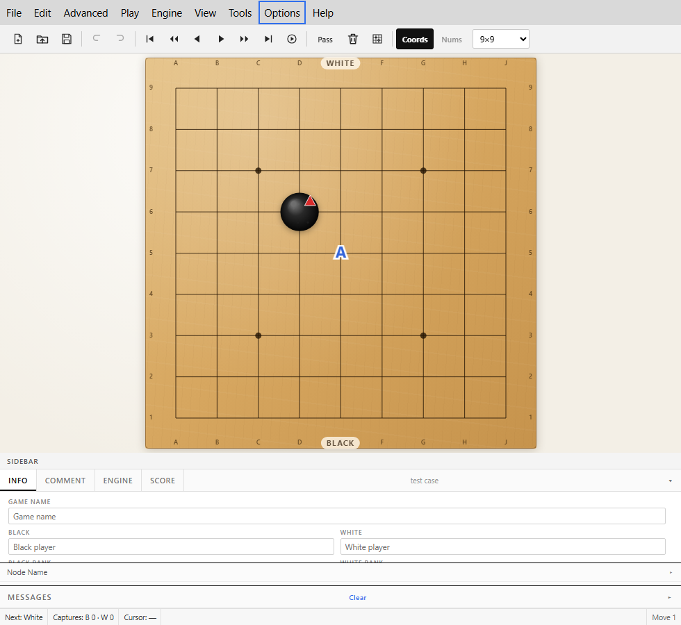

---

## 3. Distribution and installer behaviour

### 3.1 What ships

| Artifact | Purpose |
|---|---|
| `MultiGo-Neo-<version>-setup.exe` | Per-user NSIS installer; shortcuts, Apps entry and `.sgf` association. |
| `MultiGo-Neo-<version>-portable.exe` | Single-file portable Electron build; no installation. |
| `MultiGo-Neo-<version>-web.zip` (or `web-portable/`) | Browser build; unzip/copy and open `index.html`. |
| `README.md`, `Features.md`, `Tutorial.md` | Manual, feature register and beginner tutorial at the root of every package. |
| `sgf\十三路打谱操` | 17 study SGF records in the installer, portable and web builds. |

### 3.2 Multiple versions and upgrades

The installer treats every version as the **same product** (`appId com.illegear.multigoneo`,
version-independent registry keys). It is not a side-by-side installer:

| Scenario | Behaviour |
|---|---|
| 1.1.11 over 1.1.10 | Old version is uninstalled, then the new one installs; one Apps entry; user settings are kept. |
| Different install folder | Still an upgrade; the old folder is removed. |
| Older over newer | Downgrade: the newer build is uninstalled first (no version guard). |
| Uninstall | Removes app, shortcuts and `.sgf` association; `%APPDATA%` settings are kept by default. |
| Two versions installed simultaneously | Not supported by one installer identity. Use the portable exes (one at a time, single-instance lock) or the two web folders; a true side-by-side install requires a separate `appId`/`productName`. |

---

## 4. Verification

| Check | Result |
|---|---|
| `node scripts/test-tree.js` | 5 tree/SGF tests |
| `node scripts/test-path.js` | 5 position-path tests |
| `node scripts/test-scoring.js` | 13 scoring/estimate tests |
| `node scripts/test-sgf-limit.js` | 6 SGF size-limit tests |
| `node scripts/test-sgf-guard.js` | 7 SGF guard/import/save tests |
| `node scripts/verify-coord-font-ui.mjs` | toggle, margin growth/restore, played move, persistence, no console errors |
| CDP UI scripts (`scripts/verify-*.mjs`) | scoring, bowls, Estimate/Score, small boards, tree, themes, options, engines and more |

---

## 5. Gallery

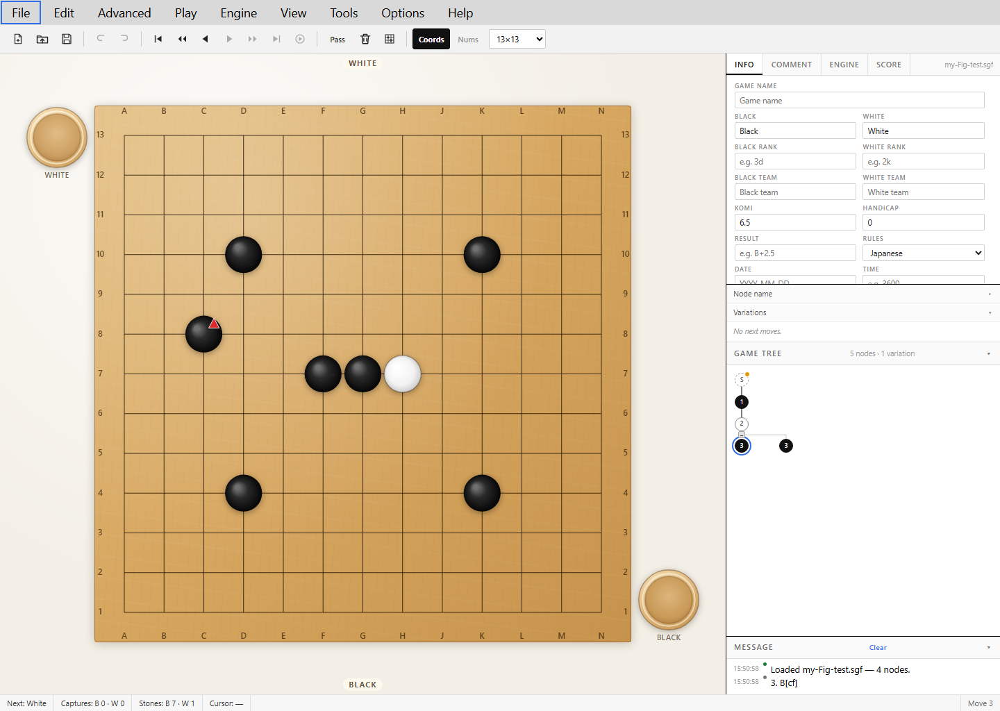

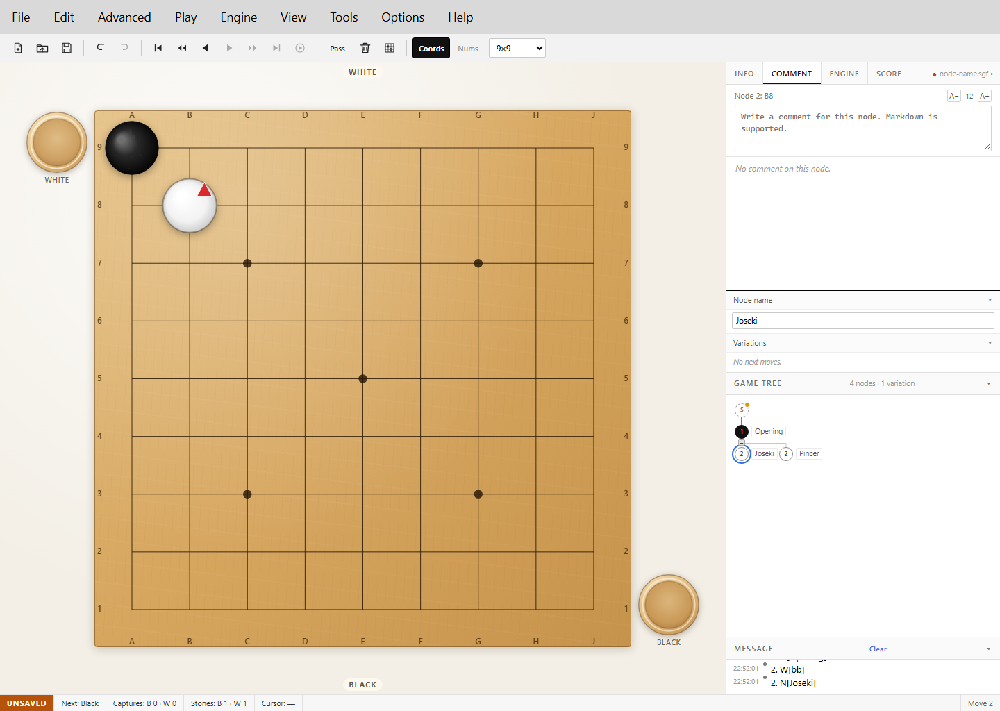

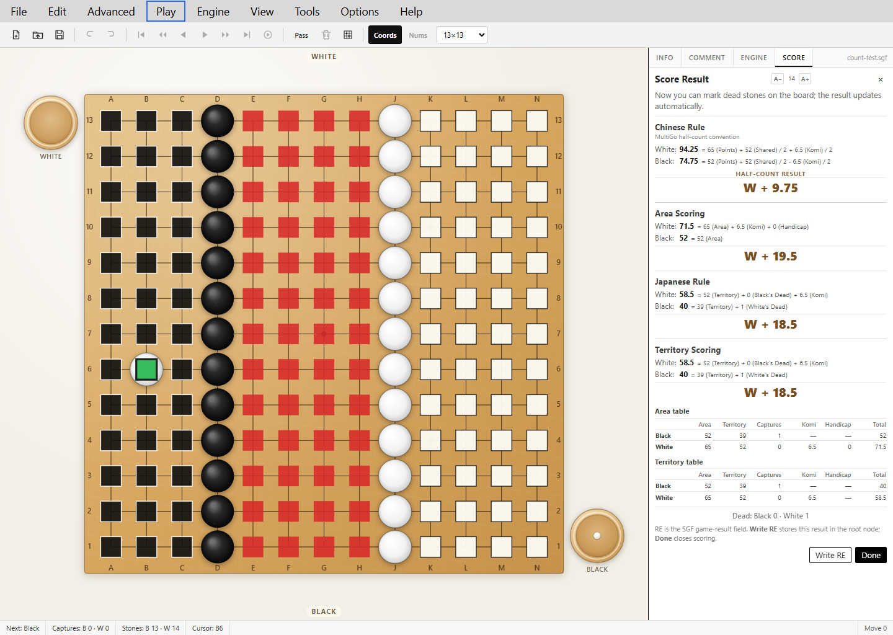

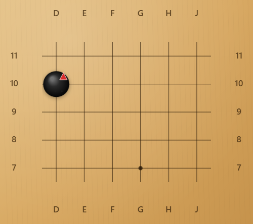

---

*Feature register for MultiGo Neo 1.1.28. For usage, shortcuts and SGF details see
[README.md](README.md). For command lookup see [Reference.md](Reference.md).*
