# MultiGo Neo

MultiGo Neo is a **tree-based Go SGF editor/player** for the desktop. Its functional
reference is [`lots/my-Sabaki`](https://github.com/lots/my-Sabaki) — a study fork of
Sabaki 0.60.2 — and the design and reference material it was built from is kept in
[`study/`](study/README.md).

This is the **core SGF editor milestone** of the migration: game tree and variations,
lossless SGF, comments, the full markup toolset, and the fork's coloured-line/dim extensions
are implemented. Scoring, GTP engines, alternate file formats, and the remaining MultiGo/
Sabaki features are planned for later phases.

The renderer also ports seven interaction ideas from BesoGo: **variation badges**, **per-tool
hover ghosts**, **deterministic stone textures**, **CSS-split board themes**, **responsive
portrait layout**, **position-path links** and **zero-JS data-attribute embeds**. Recent
additions cover **FF[4] move and non-move logging** in the Message panel, a **seven-file recent list**, compact
**pass** nodes in the game tree and the **四4** coordinate system. The View and Options menus
now use compact dropdowns, and the toolbar **Coords / Nums** labels are white and bold when
active, dimmed when off.

MultiGo Neo reads and writes **FF[4]** and adds a documented **modified-FF[4]** colour layer
(coloured `AR`/`LN` lines and `SBKDD` dim colours — see
[Modified FF[4]](#modified-ff4)). The board ships in **four themes**, previewed on 13×13
boards [below](#board-themes-and-responsive-layout).

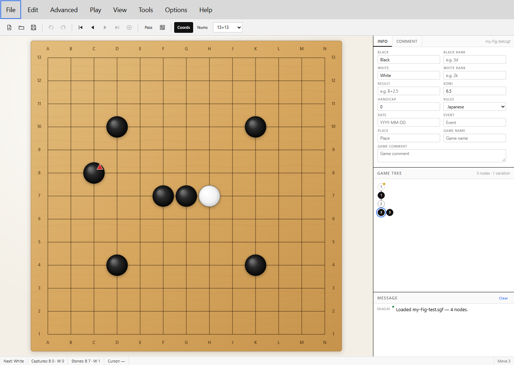

## What is implemented

### Game tree and SGF

- Immutable `@sabaki/immutable-gametree` model with real variations.
- Sabaki-style **game graph** in the lower-right panel (columns for branches, current path,
  comment badges, click to select).
- Connectors are **orthogonal tree bones** rather than long diagonal parent-child lines:
  vertical runs through a sequence plus a single clean elbow at branches.
- Every branch node has a grey **`+` / `−` collapse toggle** (MultiGo-style). Collapsing hides the
  subtree, compacts the remaining layout, keeps the selected node visible, and shows the
  visible/total node count in the panel header.
- Expanding restores the subtree; collapse state is kept while editing the same game.
- Play a move, create a variation by playing a different move from an earlier node, pass,
  and switch the player to move.
- Delete a node, make a variation main, shift it left/right, and remove sibling variations.
- Undo/redo across tree mutations.
- **Lossless SGF read/write** through `@sabaki/sgf`: unknown properties, variations, setup
  stones, comments, markup and the fork's coloured `AR`/`LN` and `DD`/`SBKDD` values survive
  a round trip.
- Pass nodes (`B[]`, `W[]`, or the legacy `tt` form on boards up to 19×19) show a compact
  **`p`** in the game tree; the tooltip and accessibility label spell out **pass**.
- New games get `GM[1] FF[4] CA[UTF-8] AP[MultiGo Neo:1.0] SZ[…]`.

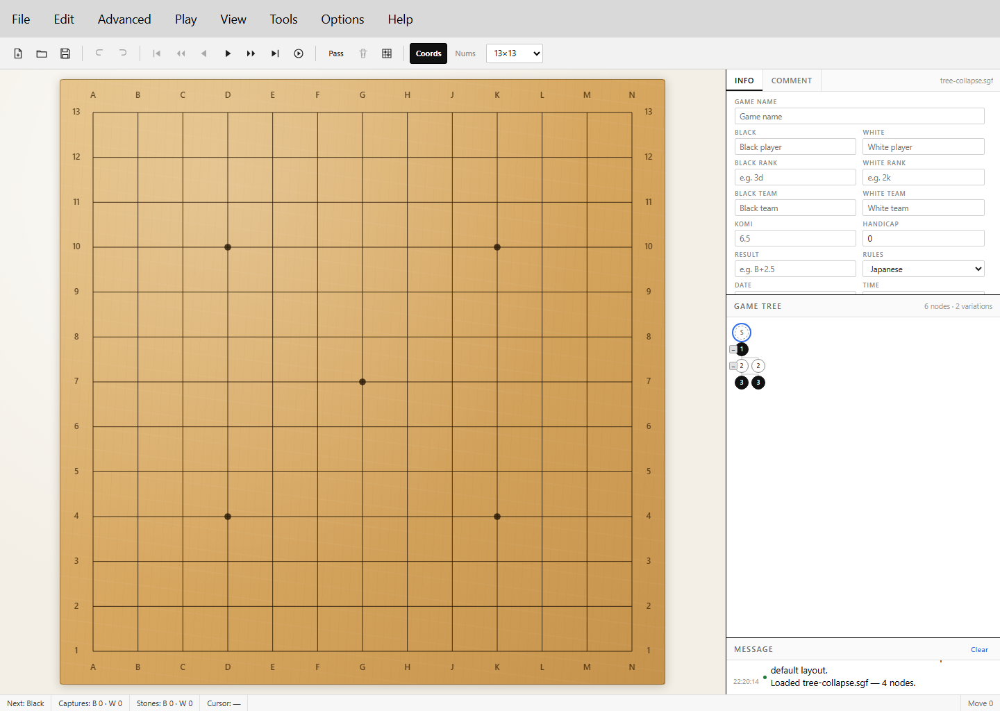

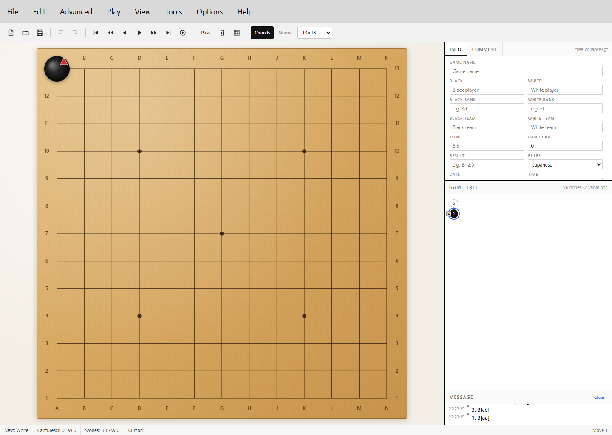

### Editing

- Tabbed **Info / Comment** panel; comments support a safe Markdown subset (bold, italic,
  inline code, links, headings, lists, blockquotes, line breaks).
- The Comment textarea starts at **three lines**, remains vertically resizable, and its
  height is remembered across launches. The same comment is rendered below the editor using
  the Markdown subset, so formatted text can be checked while editing. In Read Only mode the
  editor is hidden and only the rendered comment is shown.
- Edit tool strip: black/white stones, eraser, cross, triangle, square, circle, line, arrow,
  dim, label, and number.
- **Delete Move** is available from the toolbar in both Play and Edit modes (and from the
  Play/Edit menus or `Ctrl+Delete`); the button is disabled at the root.
- my-Sabaki palette for lines/arrows and dim rectangles: black, white, red, yellow, blue,
  green, plus the theme default.
- Coloured line/arrow values use the fork's optional third field:
  `LN[aa:ae:red]`, `AR[ha:he:blue]`.
- Dim uses standard inherited `DD[kk:mm]` plus the private `SBKDD[blue:kk:mm]` companion, so
  other SGF viewers still dim the correct area.
- Right-click erases the mark/line/dim rectangle/setup stone under the pointer (edit mode).
- Labels and numbers write `LB`; per-node comments write `C`; game comment writes `GC`.
- **AR is drawn at double the original stroke width; LN at triple.**
- The current move is always marked with a **red triangle**; variation hints are blue letters
  rather than translucent stones.
- Every successful board move writes its FF[4] property to the **Message** panel, e.g.
  `12. B[dd]` or `13. W[cc]`. Advancing with **Next**, a board click on an existing child, or a
  tree-node click logs the selected move's FF[4] codes as well.
- Non-move properties are logged too: setup (`AB/AW/AE`), markup (`CR/SQ/TR/MA/SL/LB`),
  lines/arrows (`AR/LN`), dim rectangles (`DD/SBKDD`) and `PL`, e.g. `12. DD[kk:mm]` or
  `12. AR[aa:ae:red]`. Comments stay in the Comment tab rather than flooding the log.
- Setup stone tools are toggles: clicking the same colour removes the stone, clicking the
  opposite colour replaces it.
- Board transformations and scoring are not in this milestone.

![FF[4] move and non-move properties in the Message panel](preview-property-log.png)

### Edit menu

The Edit menu now covers variation editing as well as display edits:

- Undo / redo, edit mode, game info, and node comments.
- **Cut / copy / paste the current variation** (system clipboard with an internal fallback).
- **Duplicate the current node**, **insert an empty node**, delete a node.
- Make a variation main, shift it left/right, remove sibling variations, and **flatten the
  current variation**.
- Clear node markup.
- Copy/paste the whole SGF.
- Keyboard: `Ctrl+Alt+C/X/V` for copy/cut/paste variation, `Ctrl+Alt+D/N` for
  duplicate/insert, and `Ctrl+Alt+F` for flatten.
- **Read Only** is available directly in this menu.

### Read Only

**Edit → Read Only** turns the document into a strict viewer:

- Board play, edit mode, all markup/setup tools, game-info and comment edits, variation
  operations, undo/redo, board-size changes and loading from the clipboard are blocked.
- **Save** and **Save As** are disabled and the save functions refuse to run.
- Navigation through the tree, branch selection, autoplay, copying SGF/variations, themes,
  zoom, language and viewing controls remain available.
- A red **READ ONLY** status cell and a `— Read Only` title suffix make the mode obvious.
- The comment editor is replaced by the rendered comment preview.

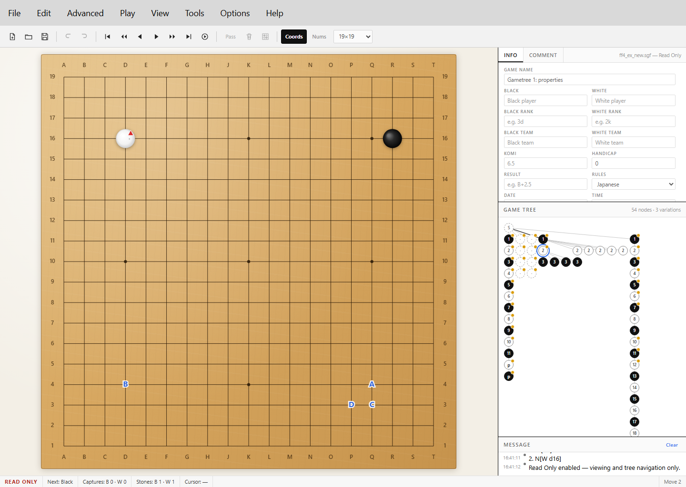

### Game Information

The Info tab now covers every field in the MultiGo Game Information dialog:

| Group | Fields |
| --- | --- |
| Common | Game Name `GN`, Black/White Player `PB`/`PW`, Black/White Rank `BR`/`WR`, Black/White Team `BT`/`WT`, Komi `KM`, Handicap `HA`, Result `RE`, Rules `RU` |
| When / where | Date `DT`, Time `TM`, Place `PC`, Round `RO`, Event `EV` |
| Other | User `US`, Source `SO`, Game Comment `GC`, Copyright `CP`, Annotation `AN` |

Values are read from and written back to the root SGF node. They are preserved when the board
size is changed and disabled while Read Only is active.

The player fields are grouped into two columns: **Black / Black rank / Black team** on the
left and **White / White rank / White team** on the right. The default Info panel is compact:
about six rows tall, showing **Game Name** through **Rules**, while the Message panel is limited
to roughly three log lines. Both panes remain resizable with their splitters.

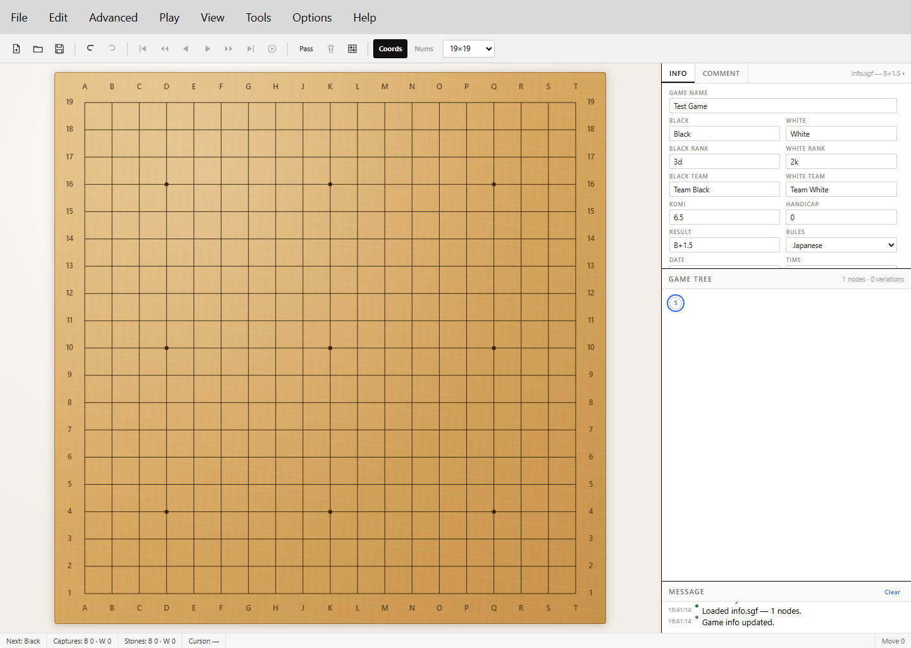

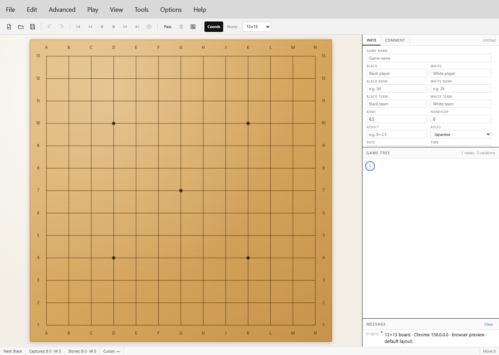

### Game Info editing focus

Choosing **Edit → Edit Game Info** now expands the right-hand Info panel to its practical
maximum before focusing the Black field: the info column takes the widest allowed share of the
workspace (82%), while the Game Tree and Message panes stay at their 48 px minima so they
remain recoverable. A **Done** button appears in the Info header; pressing it restores the
exact layout that was in use before focus. The focus layout is session-only;
**View → Reset Panel Layout** also restores the default workspace proportions.

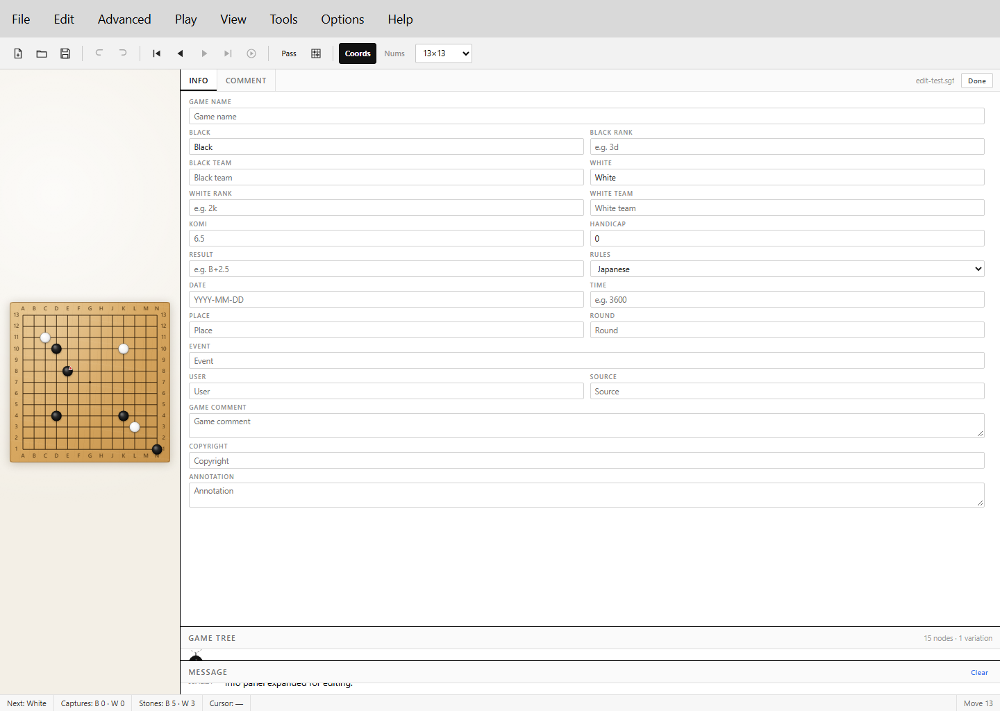

### Move numbers

Move-number display is controlled by the **View → Move Numbers** dropdown:

- **None**, **All**, **Last 10 / 25 / 50**, **Custom…**
- A second **Numbering** dropdown chooses **Game Start** or **Variation Start**.
- The toolbar **Nums** button still toggles between none and all.

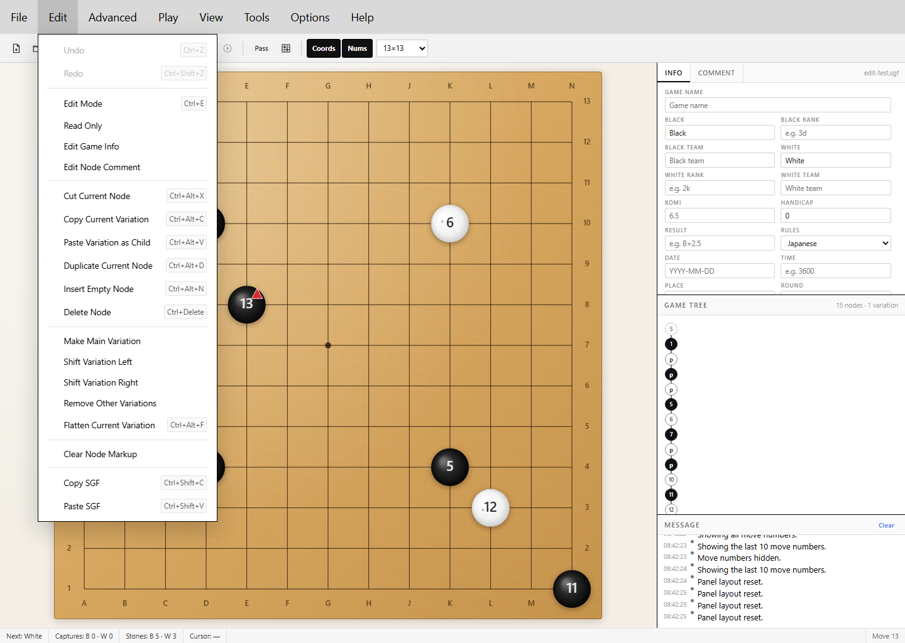

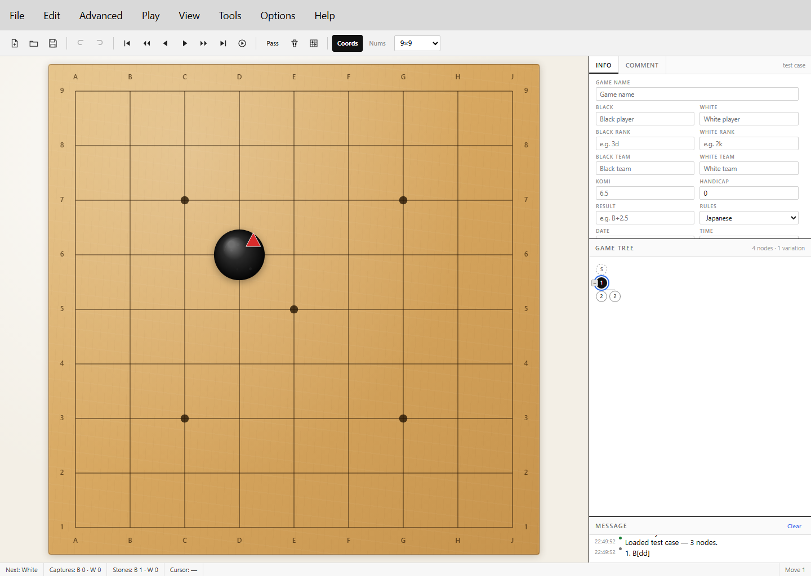

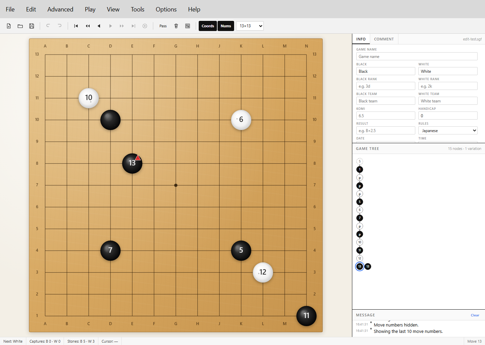

### Fast navigation

The toolbar now has **←←** / **→→** fast-rewind and fast-forward buttons, plus Play-menu
entries. Fast navigation advances by **moves**, not raw tree nodes, and stops at the root or
the end of the current branch. The number of moves is configurable in
**Options → Preferences → View → Board → Fast forward/rewind steps** and defaults to **20**.

### Recent files

The File menu keeps the **last seven opened or saved SGF files** under **Recent Files**:

- The list is numbered and deduplicated (reopening a file moves it to the top).
- In the desktop/portable build the **complete path** (folder + filename) is remembered,
  re-read through the main process, and used as the Save As default location.
- In the browser preview up to 400 KB of SGF text per entry is cached in `localStorage`, so
  recent games reopen without the original file.
- Chromium also stores the File System Access **file handle** in IndexedDB. This lets a recent
  file reopen and later save back to the same location, even though browsers intentionally hide
  the literal filesystem path.
- Missing or oversized files fail with a message; **Clear Recent Files** empties the list and
  removes the stored browser handles.

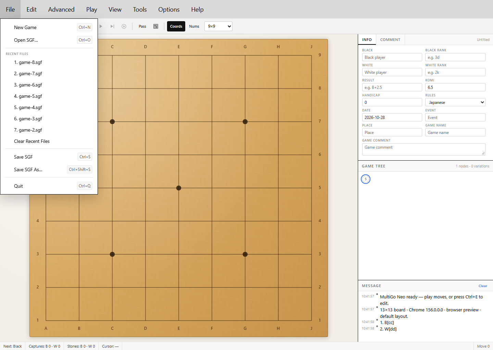

### Save/open location messages

File operations now report the actual location used in the Message panel.

**Web version:** in Chromium browsers that support the File System Access API, the first
**Save** (or any **Save As**) opens a folder/file picker, so the destination is chosen
explicitly instead of always landing in Downloads. **Save As** is prefilled with the current
file name (not a newly generated game name); accepting it overwrites the same file. Later
**Save** actions write to the same chosen file without reopening the picker. For **Save As**
the current file handle is passed as the picker's `startIn` value, so Chromium opens the
current file's folder; a fixed picker `id` makes it reopen the last selected save folder when
no handle exists. The browser deliberately does not expose the full folder path, so the
Message says “folder selected in the browser”. Firefox/Safari or browsers without the API
fall back to the normal Downloads behavior, with a message saying so.

**Portable version:** the Electron portable build does **not** use the browser download path.
It calls the native `dialog.showSaveDialog` and can write to any folder the user picks; the
dialog starts at the current file's folder (or the last chosen folder/Documents when there is
no current file), prefills the current name for **Save As**, and logs the full filesystem path.
A normal **Save** writes directly back to the current file. Installed and portable Electron
builds share this behavior.

- Browser open logs the picked filename and states that the browser does not expose its folder.
- Browser recent-cache loads identify the cached filename, and errors include the path/name
  that failed.

### Workspace

- 13×13 default, with 9×9/19×19 presets and **custom boards from 2×2 to 52×52**.
- Custom size syntax is `width*height`, e.g. `5*9` (five columns, nine rows). The wood
  surface and grid are genuinely rectangular, and `SZ[5:9]` is written to the SGF.
- Invalid custom sizes keep the dialog open and show an inline error such as
  “Each side must be an integer from 2 to 52 (60*2).”
- **The last board size is remembered across launches**, including rectangular sizes; the
  Options menu can disable or re-enable this.
- Coordinates, move numbers, last-move marker, star points, textured board.
- Coordinate systems: **A1**, **1–1**, and **四4** (Arabic column numbers with Chinese
  numerals down the rows).
- **Four CSS board themes** — Classic, Flat, Dark and Paper — with the surface, grid colours
  and stone palette driven by custom properties in `src/themes/*.css`.
- **Responsive layout**: below 1120 px the board moves above the panel column; the board keeps
  a 58% height ratio and the panels keep at least 280 px. View → Responsive Layout toggles it.
- Resizable board / Info / Game Tree / **Message** panes, remembered layout and preferences.
- The three right-hand panes can each be squeezed down to roughly **48 px**, giving the
  remaining pane almost the whole column.
- The message console has moved from the bottom edge into a resizable lower-right panel.
  The bottom status bar now contains only the status cells and the single lower rule.
- Electron native Open/Save dialogs remember the last folder, matching the fork's dialog
  convenience; the renderer has a browser download/file-picker fallback.

### View menu

The View menu now covers the practical MultiGo-style display controls:

- **Board Size** dropdown: 9×9, 13×13, 19×19 and **Custom…**
- **Coordinates** dropdown: **None**, **A1**, **1–1**, or **四4**, drawn on all four sides
- **Move Numbers** dropdown: **None / All / Last 10 / Last 25 / Last 50 / Custom…**
- **Numbering** dropdown: **Game Start** or **Variation Start**
- **Show Next Moves**: the first continuation from the current node as a blue **A** badge
- **Show Sibling Variations**: **all child variations of the current node**, labelled
  **A, B, C…** in child order, but **only when there is more than one child**. A single
  continuation is the main branch and gets no sibling marker.
- the last move keeps the **red triangle** marker in every mode
- **Responsive Layout**
- **Zoom In / Out / Reset**
- **Toggle Full Screen** (`F11`)
- **Show Game Tree** and **Reset Panel Layout**

There is deliberately no Video menu; it is not part of the Go editor.

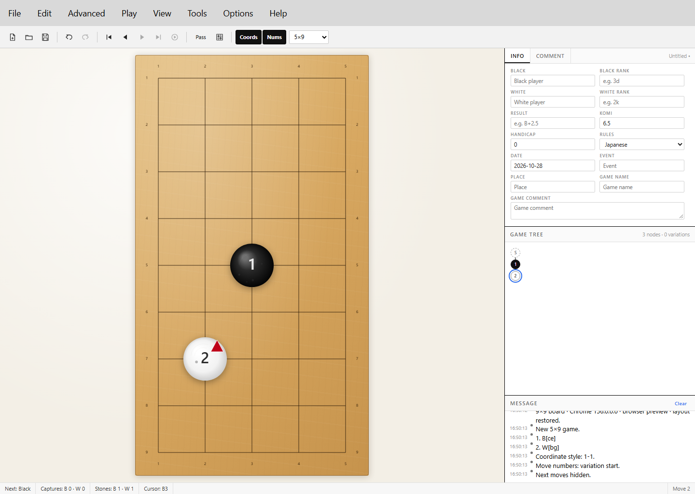

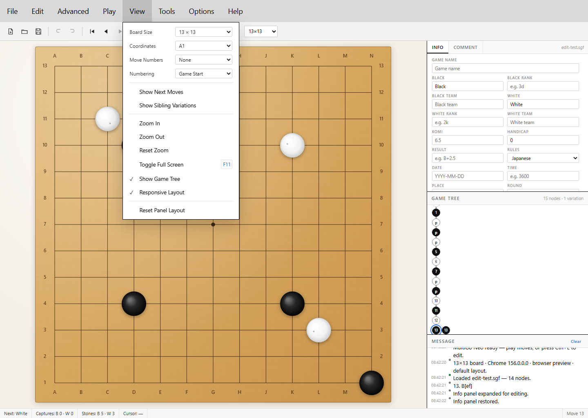

### Variation badges

The variation overlay now matches the MultiGo reference:

- **Show Next Moves** places a blue **A** at the first continuation.
- **Show Sibling Variations** places **all children of the current node** at their move
  points, labelled **A, B, C…** in child order, only when at least two children exist. A
  single main branch produces no marker. It does not read the current node's parent's other
  branches.
- No translucent ghost stones are drawn for these variation hints: the board shows only the
  blue letters, so the position is not visually polluted.
- This was verified against `ff4_ex_new.sgf`: the 19×19 node with six continuations shows
  **A–F**, and the following `W d16` node shows **A–D**, matching the good MultiGo captures.

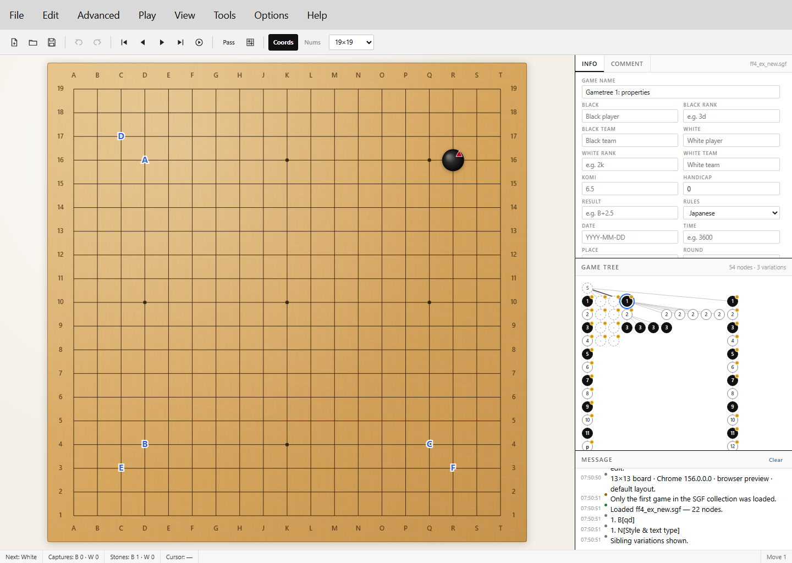

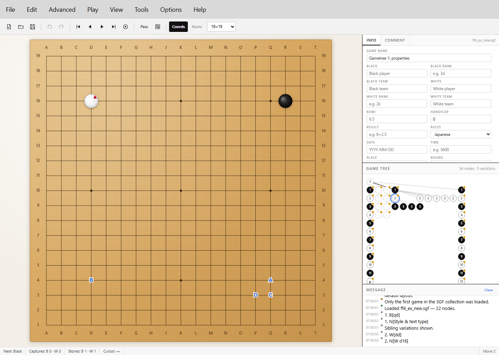

Hover ghosts are still used for the active edit tool: a ghost stone in play mode; setup
stone/cross/replacement plus; markup shapes; the next number or existing label; and a dashed
line/arrow/dim preview.

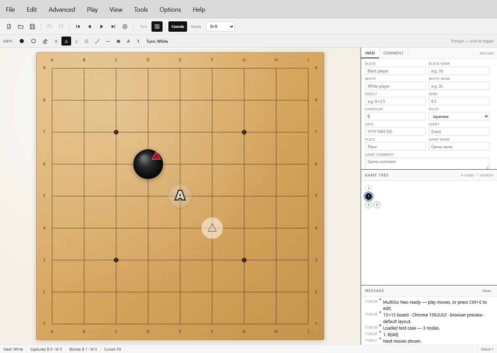

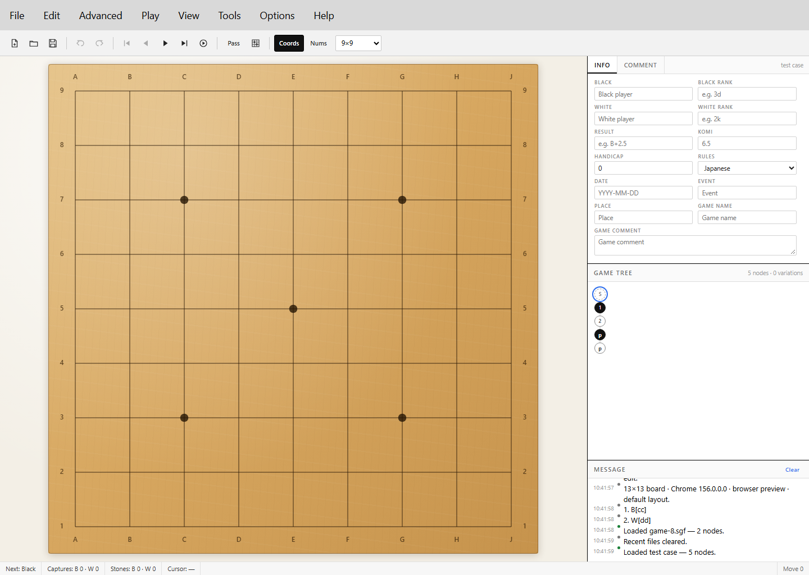

### Board themes and responsive layout

Four CSS-only board themes ship with the app: **Classic**, **Flat**, **Dark** and **Paper**.
Pick one in **Options → Theme**; the choice is remembered across launches. A theme only
changes the board surface, grid, labels and stones — the shell stays the same. All four
images below show the same **13×13** position at 1440×1024.

| Classic | Flat |
| --- | --- |
| 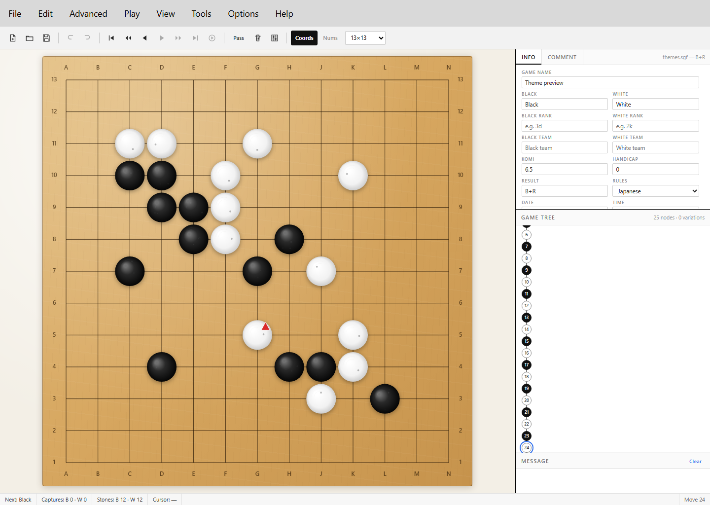 | 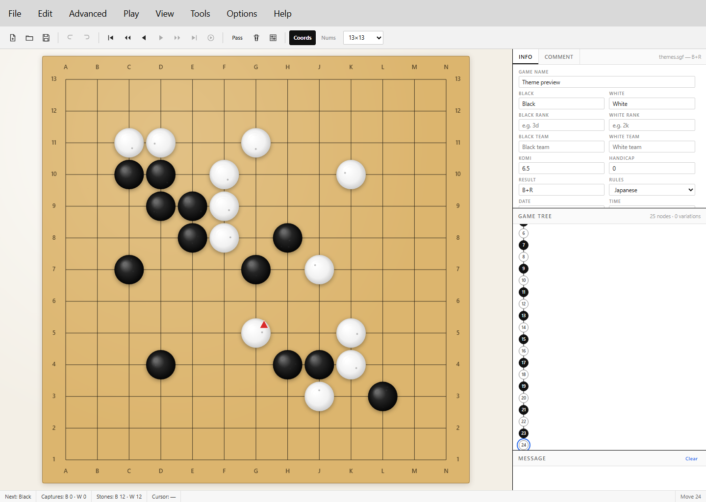 |

| Dark | Paper |
| --- | --- |
| 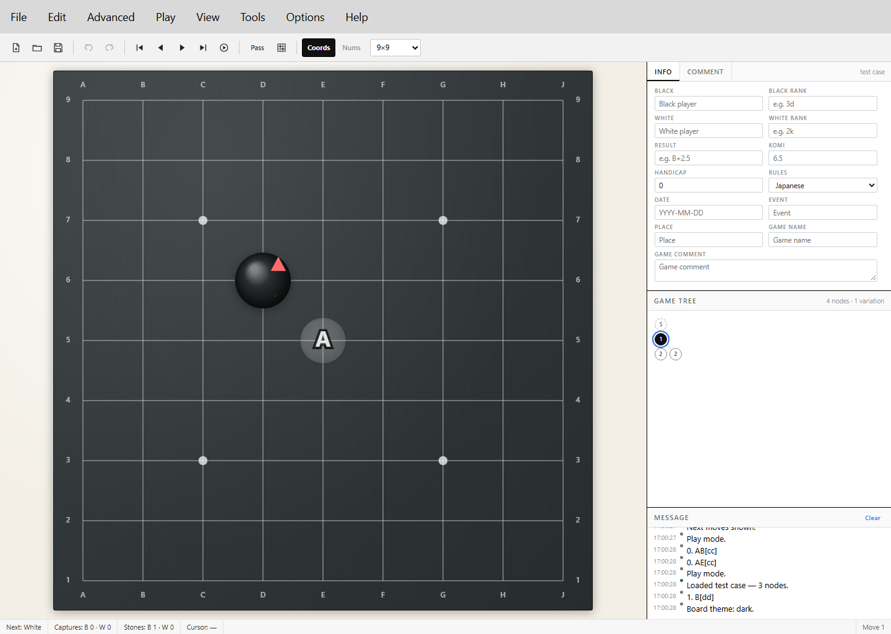 | 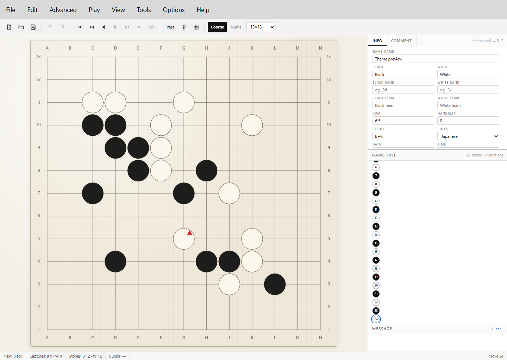 |

- **Classic** — warm kaya wood with CSS-only grain; the default.
- **Flat** — a solid board colour with no grain.
- **Dark** — old rosewood with a golden-brown grid and warm stone highlights, based on the
  old-board photographs in `study/design/old-board/`; the stones get a glassy top-left
  specular cap and a warm lower rim so black stones separate from the dark wood.
- **Paper** — light diagram paper, thin ink lines and flat printed stones (no gradient,
  drop shadow or highlight), for print-like review diagrams.

Palettes live in `src/themes/classic.css`, `flat.css`, `dark.css` and `paper.css`; the
renderer reads their custom properties on each switch, so the canvas stays transparent over
the CSS surface. `node scripts/verify-themes-ui.mjs <port> .` regenerates the four
screenshots against a DevTools-enabled Chromium.

Below **1120 px** the workspace switches to a portrait column: the board sits on top at 58%
of the available height, the panel column fills the rest, and the vertical splitter hides.
The layout returns to the remembered landscape proportions when the window grows again.

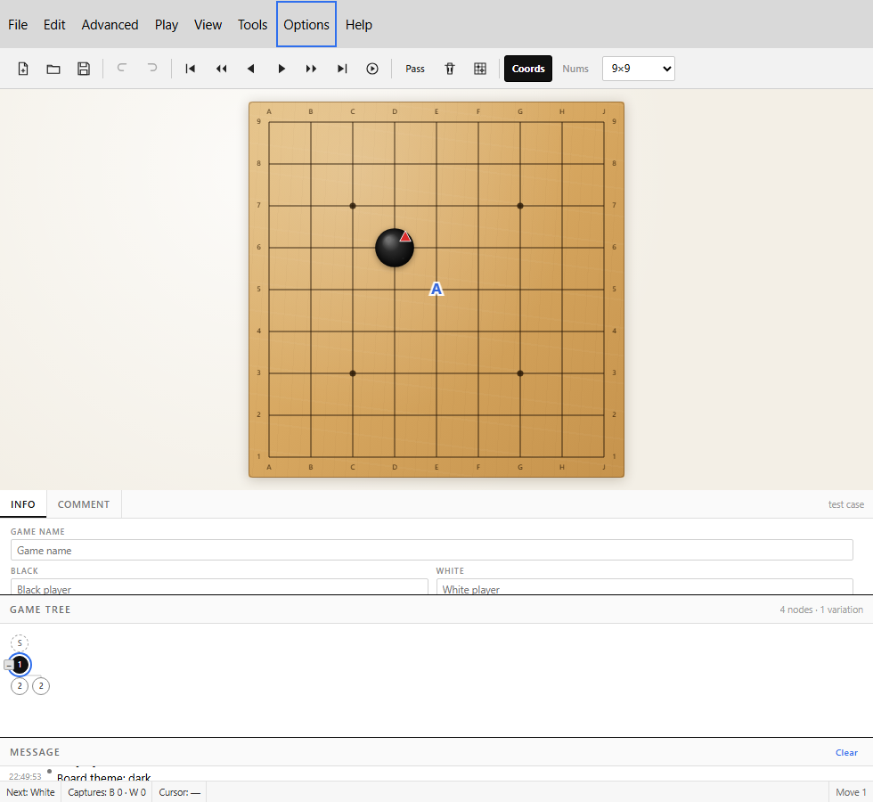

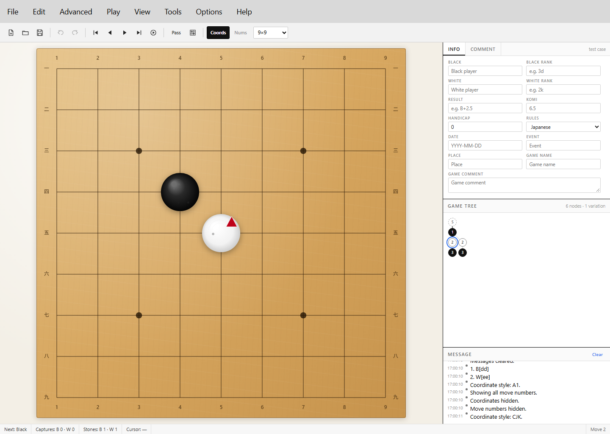

### Position links

The compact path DSL is shared with the embed viewer (`src/path-spec.js`):

- `N<n>` / `n<n>` moves forward along first children; a bare number is next mode.
- `B<n>` / `b<n>` selects the n-th child (1-based, `0` = last child).
- Other characters are separators. `20`, `n5b1b1` and `b2,3,0,1` are all valid.

**Tools → Copy Position Link** puts a self-contained link on the clipboard:
`index.html?sgf=<encoded SGF>&path=<spec>`. Opening it restores the game and jumps to the
position. Electron accepts the same value as `--path=<spec>`; the path is applied as soon as
an SGF is opened.

### Embeddable viewer

`src/embed.html` demonstrates the zero-JS embed: include `sabaki-bundle.js`,
`path-spec.js`, `embed.js` and the theme sheets once, then write plain markup.

```html
<div data-multigo
     data-sgf="(;FF[4]GM[1]SZ[9];B[ee];W[cc])"
     data-path="2"
     data-theme="dark"
     data-coords
     data-variations
     data-width="420"></div>
```

Supported attributes: `data-sgf`, `data-path`, `data-size` (empty board), `data-theme`,
`data-coords` (optionally `1-1`), `data-variations`, `data-controls="false"`, `data-width`
and `data-label`. Widgets support click/wheel/keyboard navigation and a hover stone.

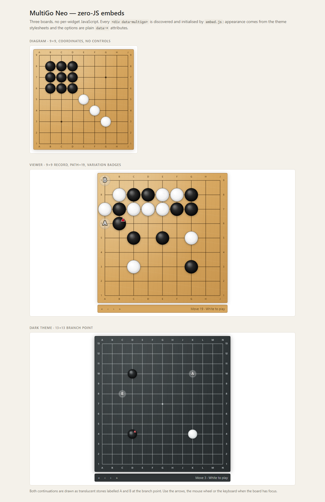

### Language and Options

- Options now offers a **Language** dropdown with **English / 简体中文**. Switching language
  immediately translates the menus, toolbar, tabs, panel titles, game-info labels, rules,
  status cells, dialogs and option labels; the choice is persisted across reloads.
- The Chinese shell is demonstrated below:

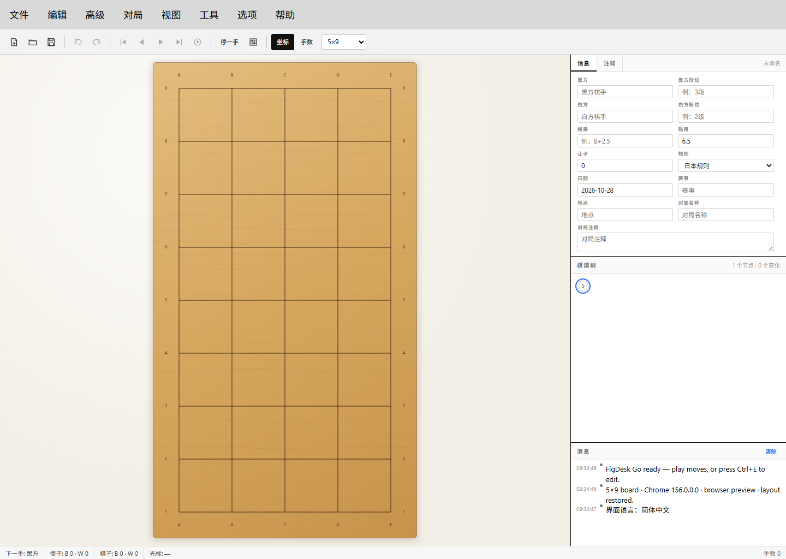

- Additional Options: **Remember Last Board Size**, a **Theme** dropdown (Classic / Flat /
  Dark / Paper), an **Autoplay Delay** dropdown (0.5/1/2/3 s), Preferences, and **Reset All
  Settings**.
- Runtime log entries and SGF/game content stay in their original language.

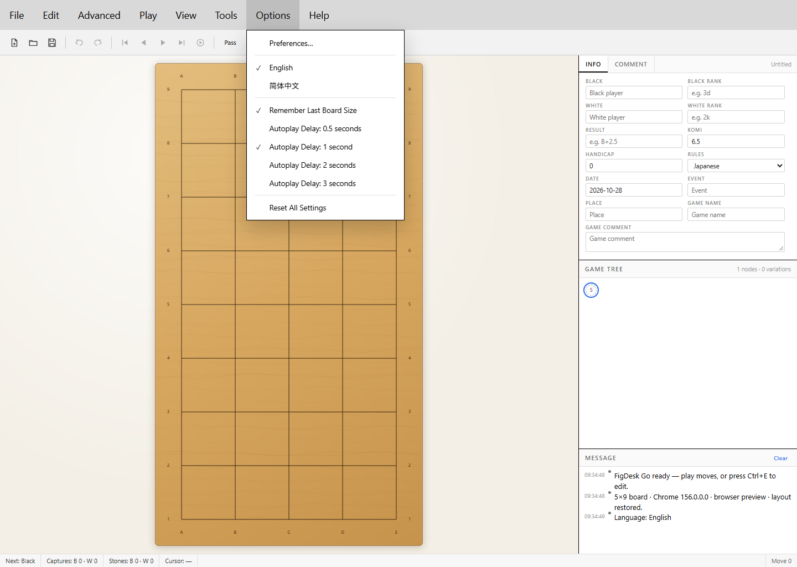

### Options → Preferences

The former **Set Up…** entry has been merged into **Options → Preferences…**. The single
Preferences dialog follows the MultiGo Options categories:

- **Board** — theme, brightness, show coordinates, coordinate style, default board size and
  **Fast forward/rewind steps** (default 20).
- **Stones** — enable/disable the procedural stone texture.
- **Markers & Numbers** — focus marker (triangle / dot / none), focus colour,
  hide markup, show next moves, show sibling variations, move-number range, numbering mode,
  and label start character.
- **Other** — show the game result in the window/file title.
- **Traverse** — move sound, auto-play interval, and “visit variation branch first”.
- **Edit** — default Komi, White moves first in new games, right-click board removes the
  current move, and open existing files as Read Only.

Options take effect on **OK**; **Cancel** discards changes, and **Reset Defaults** only resets
the dialog controls until OK is pressed. Values persist in `localStorage`.

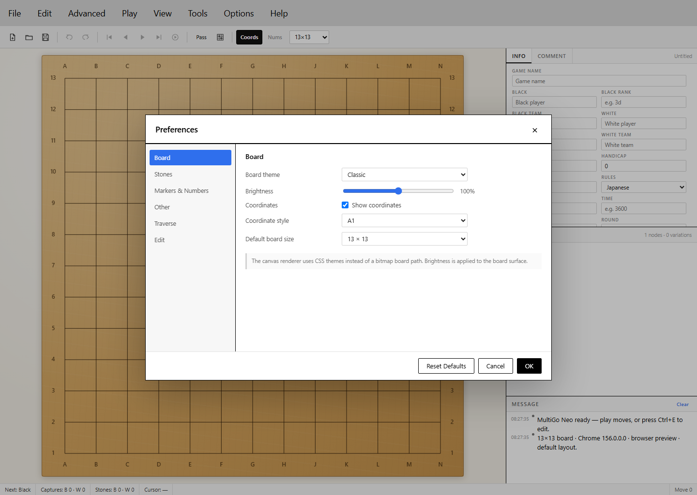

MultiGo bitmap-board/stone image paths, random stone images, window-side/tree-position choices,
custom panel background colours, BIG5 auto-detection, new-file templates, branch merging and
resume-last-position are not applicable or are not implemented in the canvas-only
architecture; the dialog notes these limitations.

## Verification

10 tests (`npm test`) cover variations, unknown-property preservation, immutable tree
mutation, captures, custom rectangular sizes, the 52-point alphabet, markup round-trips and
the position-path parser/resolver (including build/resolve round-trips through every branch).
The legacy pure-Go helper tests remain available as `npm run test:legacy`.

The UI was driven in Chromium at exactly 1440×1024, plus a 980×900 pass for the responsive
layout and a 1100×1700 pass for the embed page:

- played a main line and created a sibling variation from the root;
- undone/redone and deleted a node, then undone the deletion;
- placed a setup stone, cross, line, red line, dim rectangle, blue dim rectangle, number and
  label; erased the cross by right-clicking;
- wrote and previewed a Markdown comment;
- loaded an SGF containing an unknown `ZZ` property and two variations, then wrote it back
  with the same structure and values;
- created a **5×9** board through the Custom… dropdown, confirmed the rectangular surface,
  and checked the 52×52 and 2×52 limits;
- exercised the View dropdowns for board size, coordinates, move numbers and numbering,
  next-move hints, zoom, game-tree hiding, and reset;
- entered an invalid custom size (`60*2`), confirmed the dialog stayed open with the inline
  range error, then entered `5*9` successfully;
- reloaded the page and confirmed the **5×9 board** and the selected **Chinese** language
  both survive;
- resized the Message panel with its splitter and confirmed the bottom bar is now a single
  24 px status row with no message log;
- squeezed the Info, Game Tree and Message panes down to their small state, including a
  48 px Game Tree;
- verified AR/LN line widths of **3.6 px / 5.4 px**;
- used **Insert Empty Node**, **Duplicate**, **Copy/Paste Variation**, **Flatten** and
  **Cut** from the expanded Edit menu, restoring each with Undo;
- confirmed the last move is marked with a **red triangle**;
- changed **Move Numbers** and **Numbering** through their View dropdowns;
- confirmed the autoplay icon is distinct from First Child, the status bar has only the lower
  rule, and the menu bar contains no Video item;
- loaded a six-node two-branch SGF and confirmed every tree connector path is orthogonal
  (`M/V/H`, no diagonal `L`); used the branch toggles to collapse 6 nodes to 2 (label `2/6
  nodes`), saw the `+` state and current node move to the collapsed branch, then expanded back
  to 6 with the `−` state;
- loaded `ff4_ex_new.sgf` and confirmed **Show Sibling Variations** labels all six children
  of the `Style & text type` node **A–F** (D16, D4, Q4, C17, C3, R3), and all four children
  after `W d16` **A–D**; no parent-sibling badges or ghost stones leaked onto the board;
- verified the last move uses the **red triangle**, and the hover ghost stays available;
- checked the toolbar **Coords / Nums** labels: white bold when active, dimmed when off;
- confirmed the compact View menu has four dropdowns and a working Show Sibling Variations
  entry;
- enabled **Edit → Read Only**: the game tree was locked, play produced no node, Save/Save As
  were disabled, Info/comment/board-size controls were disabled, and tree navigation still
  worked; the red **READ ONLY** status cell appeared and disappeared correctly;
- populated every Game Information field from SGF and edited Source `SO` successfully;
- confirmed the Comment tab starts with a three-line editor and shows the rendered Markdown
  comment below it; a 120 px resize survived reload, while Read Only still shows only the
  rendered preview;
- chose **Edit → Edit Game Info** and confirmed the info panel grew to 1180×802 px at
  1440×1024, the Game Tree and Message panes stayed at 48 px, the Info tab was active and the
  Black field received focus;
- pressed the new **Done** button and confirmed the panel returned to its earlier
  394×324 px / 1045 px board layout and the button hid itself;
- confirmed Black/Black rank/Black team share the left column and White/White rank/White team
  the right column; the initial Info panel was 324 px tall, showed Game Name through Rules, and
  the Message panel was 81 px (two visible log lines);
- confirmed **Show Sibling Variations** produced no hint for a single main continuation and
  two hints at a real two-child branch;
- used the **←←/→→** toolbar buttons and Play-menu commands: fast forward moved 20 moves,
  fast rewind returned to the root; the Preferences step count accepted 5 and reset to 20;
- deleted a move from both Play and Edit modes using the new toolbar Delete Move button;
- opened **Options → Preferences**, verified six categories, applied theme/brightness/coordinates,
  stone-texture, focus-marker/colour, hidden markup, next/sibling hints, move-number range,
  numbering, label character, result title, sound, autoplay interval, fast-step count,
  variation preference, Komi, White-first, right-click undo and open-as-Read-Only settings;
- confirmed Cancel left settings unchanged and Reset Defaults only reset the dialog until OK;
- created a new game and confirmed the selected Komi and White-first defaults reached the SGF
  root; opening a file with open-as-Read-Only enabled locked it automatically;
- advanced with the Next control and confirmed the Message panel logs the selected move's
  FF[4] code;
- navigated to a node containing `CR`, `AR`, `LN`, `DD` and `SBKDD`, and confirmed all five
  property codes appear; also confirmed setup, markup, line, dim and `PL` edits log the
  updated property immediately;
- switched to the **Dark** theme through the Options dropdown and confirmed the old-board
  colours, golden grid, glassy black-stone specular highlight and warm rim;
- switched to the **Paper** theme and confirmed flat printed stones: solid black center
  `rgb(29,29,27)`, solid warm-white center `rgb(251,247,237)`, and thin ink outlines;
- switched **Language** and **Autoplay Delay** through their dropdowns and confirmed the
  values were applied;
- emulated **980×900** and confirmed the portrait workspace, hidden vertical splitter and
  450 px board pane; restored 1440×1024 afterwards;
- opened `?sgf=…&path=B1B2` and confirmed move 2 / `W[cc]` was selected;
- confirmed the setup stone tool toggles the same point between `AB` and `AE`;
- loaded `src/embed.html` and confirmed three auto-initialised widgets, 3/19/3 move cursors,
  the dark theme class and non-zero canvases;
- confirmed the message log prints the FF[4] move property (`1. B[cc]`, `2. W[dd]`);
- added ten recent files, confirmed the **seven-entry cap**, menu fit and the numbered labels,
  reopened the newest entry, then cleared the list;
- confirmed browser loads report the filename and “browser file picker (original folder
  unavailable)”; a stubbed File System Access picker used for **Save As** suggested the current
  filename `existing.sgf`, used the remembered `multigo-sgf-save` picker ID, wrote the SGF, and
  the following **Save** reused the same handle without reopening the picker; a further
  **Save As** passed the file handle as the picker's `startIn` folder and used the new current
  name;
- Electron sends the current full `filePath` into the Save As dialog so the native picker opens
  in the current file's folder (native runtime remains unexercised headlessly);
- confirmed the no-picker fallback still reports `Downloaded …` and the browser-controlled
  download location; Electron paths use the full filesystem path returned by the native dialog;
- loaded a record ending in `B[]`, `W[]` and confirmed both tree nodes show **`p`** with the
  `pass` tooltip;
- switched coordinates to **四4** and confirmed Arabic column numbers with Chinese row numerals;
- no console exceptions.

Screenshots: [main editor](preview.png), [custom 5×9 board](preview-custom.png),
[View menu](preview-view-menu.png), [Edit menu](preview-edit-menu.png),
[all six sibling variations A-F](preview-variation-node23.png),
[all four variations A-D after W d16](preview-variation-node24.png),
[Read Only mode](preview-readonly.png), [Game Information fields](preview-game-info.png),
[merged Options Preferences dialog](preview-preferences.png),
[compact initial Info layout](preview-r17-layout.png),
[focused Game Info panel](preview-info-focus.png),
[restored layout after Done](preview-info-restored.png),
[red last-move triangle](preview-last-move.png), [last 10 move numbers](preview-move-numbers.png),
[FF[4] property log](preview-property-log.png),
[Chinese interface](preview-chinese.png), [Options menu](preview-options-menu.png),
[edit tools](preview-edit.png), [comment tab](preview-comment.png),
[triangle hover ghost](preview-hover-tool.png),
[pass nodes](preview-pass-tree.png), [recent files](preview-recent.png),
[orthogonal game tree](preview-tree-expanded.png), [collapsed branch](preview-tree-collapsed.png),
[四4 coordinates](preview-cjk.png),
[classic theme](preview-theme-classic.png), [flat theme](preview-theme-flat.png),
[dark theme](preview-theme-dark.png), [paper theme](preview-theme-paper.png),
[portrait layout](preview-portrait.png) and [embeds](preview-embed.png).

The four theme images are the same 13×13 position captured at 1440×1024 by
`scripts/verify-themes-ui.mjs`.

**Electron caveat:** the dependencies are installed (Electron 37.10.3), but the Electron
runtime cannot reach `app.ready` in this headless agent session (Chromium crashpad:
`not connected`). The native window, native dialogs and installers were not exercised here.
Run `npm start` from a normal interactive desktop terminal.

## Install on Windows

MultiGo Neo ships as a normal Windows application — no Node.js, no internet connection and
no Microsoft Store required.

1. Download **`MultiGo-Neo-1.1.0-setup.exe`** from the
   [Releases page](https://github.com/lots/my-MultiGoNeo/releases), or build it yourself
   (see *Standalone build* below).
2. Run the installer. It is per-user by default, so it does not ask for administrator
   rights, and it lets you choose the install folder, a desktop shortcut and a Start-menu
   entry.
3. Launch **MultiGo Neo** from the shortcut.

`MultiGo-Neo-1.1.0-portable.exe` is the same app as a single portable executable — copy it
to a USB stick and run it; nothing is installed.

**Requirements:** Windows 10 or Windows 11, 64-bit (x64). Windows 11 on ARM runs the x64
build through the built-in emulation.

**Offline:** the app never needs a network connection. All code, styles, themes, icons and
SGF libraries are packed inside `app.asar`, every resource loads from `file://`, and the
pages carry `connect-src 'none'` in their Content-Security-Policy. There is no
auto-updater, no telemetry and no CDN.

**Unsigned build:** the installers are not code-signed, so SmartScreen may show
"Windows protected your PC" the first time. Choose **More info → Run anyway**. Signing with
an Authenticode certificate removes the warning.

## Clone and run

```powershell
git clone https://github.com/lots/my-MultiGoNeo.git
cd my-MultiGoNeo
npm ci            # dependencies, including the Sabaki libraries and esbuild
npm start         # Electron window
```

`npm ci` restores `node_modules/` from `package-lock.json`. `src/sabaki-bundle.js` is
committed, so the browser preview works without a build step.

## Run

```powershell
npm start          # Electron window
npm test           # tree/SGF + path-spec tests
npm run test:path  # position-path parser only
npm run test:legacy
npm run bundle     # rebuild src/sabaki-bundle.js after changing src/vendor or src/sabaki-entry.js
npm start -- --path=B1B2   # Electron opens with a pending position path
```

Browser previews:

```powershell
start src\index.html
start src\embed.html   # zero-JS embed examples
```

Standalone build:

```powershell
npm run icon       # regenerate build/icon.ico (equivalent: scripts/make-icon.ps1)
npm run pack       # unpacked app in release/win-unpacked
npm run dist:win   # NSIS installer + portable exe in release/
```

Artifacts:

- `release/MultiGo-Neo-1.1.0-setup.exe` — NSIS installer (per-user, selectable folder).
- `release/MultiGo-Neo-1.1.0-portable.exe` — single-file portable build.
- `release/win-unpacked/MultiGo Neo.exe` — unpacked application.

The first build downloads the NSIS toolchain once into `ELECTRON_BUILDER_CACHE`;
`electronDist` points at `node_modules/electron/dist`, so the Electron binary is not
downloaded again. Code signing is skipped unless a certificate is configured
(`CSC_LINK` / `CSC_KEY_PASSWORD`).

## Controls

| Action | How |
| --- | --- |
| Play | Click an intersection |
| Move log | Message panel shows `N. B[xy]` / `N. W[xy]` and non-move codes such as `DD[...]`, `AR[...]`, `LN[...]` |
| Recent files | File → Recent Files (last 7) |
| Coordinate style | View → Coordinates dropdown (None / A1 / 1–1 / 四4) |
| Board size | Toolbar or View → Board Size dropdown; `Custom…` accepts `5*9` |
| View modes | View dropdowns: board size, coordinates, numbers, numbering |
| Next-move hint | View → Show Next Moves (current branch only) |
| Sibling hints | View → Show Sibling Variations (all child variations, A/B/C…) |
| Tree branches | Click `−`/`+` beside a branch node to collapse/expand its subtree |
| Board theme | Options → Theme dropdown or Options → Preferences → View → Board |
| Preferences | Options → Preferences…; OK applies, Cancel discards |
| Read Only | Edit → Read Only; navigation only, save disabled |
| Comment editor | Comment tab; three-line editor, vertically resizable, height remembered; rendered Markdown below |
| Edit Game Info | Edit → Edit Game Info; maximizes the Info panel and focuses Black; **Done** restores the previous layout |
| Responsive layout | View → Responsive Layout (auto below 1120 px) |
| Copy position link | Tools → Copy Position Link |
| Position path | `?sgf=…&path=…` or Electron `--path=…` |
| Language | Options → Language dropdown |
| Coords / Nums buttons | White bold when active, dimmed when off |
| Message panel | Lower-right panel; resize with its splitter, clear with Clear |
| Full screen | `F11` |
| Pass | `P` or toolbar Pass |
| Edit mode | `Ctrl+E` or the edit button |
| Tools | `Ctrl+1`…`Ctrl+9`; dim is `Ctrl+Shift+D` |
| Line/arrow/dim colour | Colour swatches in the edit bar |
| Erase a mark | Right-click it in edit mode |
| Parent / first child | `↑` / `↓` |
| Sibling variations | `←` / `→` |
| Root / end of variation | `Home` / `End` |
| Auto-play / pause | `Space` |
| Toggle player to move | `Ctrl+Shift+P` |
| Delete move | Toolbar Delete Move, Play/Edit menu, or `Ctrl+Delete`; works in Play and Edit |
| Fast rewind / forward | Toolbar ←← / →→ or Play menu; step count in Preferences → View → Board |
| Cut / copy / paste variation | `Ctrl+Alt+X` / `Ctrl+Alt+C` / `Ctrl+Alt+V` |
| Duplicate / insert node | `Ctrl+Alt+D` / `Ctrl+Alt+N` |
| Flatten variation | `Ctrl+Alt+F` |
| Move-number count | View → Move Numbers dropdown |
| Undo / redo | `Ctrl+Z` / `Ctrl+Shift+Z` |
| New / open / save SGF | `Ctrl+N` / `Ctrl+O` / `Ctrl+S` |
| Save SGF As | `Ctrl+Shift+S` |
| Copy / paste SGF | `Ctrl+Shift+C` / `Ctrl+Shift+V` |
| Menus | `Alt+F / E / A / P / V / T / O / H` |
| Help | `F1` |

## SGF support and limits

### Modified FF[4]

Game files are SGF **FF[4]**, and standard FF[4] from other editors opens unchanged. On top
of the format, MultiGo Neo writes a small, documented extension set — the **modified FF[4]**
dialect inherited from the my-Sabaki fork — so colours survive a save/load round trip:

| Extension | Written as | Notes |
| --- | --- | --- |
| Coloured lines and arrows | `LN[aa:ae:red]`, `AR[ha:he:blue]` | The optional third component names the colour: `black`, `white`, `red`, `yellow`, `blue`, `green`. |
| Coloured dim rectangles | `DD[kk:mm]` plus `SBKDD[blue:kk:mm]` | The standard `DD` still dims the region in other viewers; the private `SBKDD` companion stores the colour. |
| Producer tag | `AP[MultiGo Neo:1.0]` | Identifies the app in newly created files. |

Everything else stays untouched FF[4]: unknown properties, variations, setup stones, comments
and markup are preserved losslessly, which the round-trip tests cover. Other readers ignore
`SBKDD` and keep dimming the correct area from `DD`; a reader that does not implement the
fork's colour extension may ignore or mis-read the third `AR`/`LN` value.

Supported root properties: `GM`, `FF`, `CA`, `AP`, `SZ`, `PB`, `BR`, `PW`, `WR`, `RE`,
`KM`, `HA`, `RU`, `DT`, `EV`, `PC`, `GN`, `GC`, `C`.

Setup and markup: `AB`, `AW`, `AE`, `PL`, `B`, `W`, `C`, `CR`, `MA`, `SQ`, `TR`, `LB`, `L`,
`AR`, `LN`, `DD`, `SBKDD`, `BM`, `TE`, `DO`, `IT`.

Known limitations of this milestone:

- **Only the first game tree in a collection is loaded.** Saving writes that one tree.
- **No NGF, GIB or UGF import.** SGF only for now.
- **No find/hotspot mode, guess mode, scoring/estimator, or dead-stone marking.**
- **No GTP engine support** yet (planned after the core editor).
- Markdown is a safe subset, not full Sabaki react-markdown; code blocks and images are not
  rendered as code/images.
- No user theme/texture **directory** (the four built-in CSS themes are fixed), no
  board-transformation UI, and no full localization of runtime log messages (the editor
  interface itself is bilingual).
- `HA` is stored as a root property; automatic handicap stone placement is not applied.
- Star points on very large or irregular boards use the simple edge/centre rule, not a
  tournament-specific hoshi table.
- Display labels above 25 columns continue with `AA`…`AZ`; SGF coordinates use the standard
  `a`–`z`/`A`–`Z` 52-point alphabet.
- The dialog-folder memory is in-memory for the current app session.

## Architecture

```
src/sabaki-entry.js       imports the Sabaki libraries + my-Sabaki modules
src/vendor/gametree.js    adapted from my-Sabaki (MIT): board/markup extraction, game info
src/vendor/linecolor.js   adapted from my-Sabaki (MIT): coloured AR/LN values
src/vendor/dim.js         adapted from my-Sabaki (MIT): DD/SBKDD rectangles
src/sabaki-bundle.js      esbuild IIFE bundle exposing window.SabakiLibs
src/path-spec.js          position-path parser/resolver/builder, shared with the embed
src/index.html            menus, toolbars, tabs, board, graph, dialogs
src/styles.css            MultiGo Neo shell, edit bar, tabs, graph, comments, portrait layout
src/themes/*.css          Classic / Flat / Dark / Paper board palettes (CSS custom properties)
src/renderer.js           tree state, canvas rendering, tools, themes, overlays, file actions
src/embed.html            zero-JS embed examples
src/embed.js              auto-init canvas viewer for [data-multigo] elements
src/embed.css             embed widget and demo-page styles
electron/main.js          native window, dialogs, folder memory, IPC, --path
electron/preload.js       contextBridge API
scripts/test-tree.js      5 tree/SGF/go-board tests
scripts/test-path.js      5 position-path tests
scripts/test-engine.js    legacy coordinate/rules tests
scripts/verify-port-ui.mjs CDP test for the seven ported ideas and screenshots
scripts/verify-requests-ui.mjs CDP test for FF[4] logs, recents, pass labels and 四4
scripts/verify-menu-ui.mjs CDP test for dropdown menus, branch hints, toolbar state and nav logs
scripts/verify-properties-ui.mjs CDP test for FF[4] logging of non-move properties
scripts/verify-tree-ui.mjs CDP UI smoke test and screenshot generator
scripts/verify-view-ui.mjs CDP test for custom boards and View controls
scripts/verify-options-ui.mjs CDP test for validation, messages, language and persistence
scripts/verify-edit-ui.mjs CDP test for Edit operations, panel limits and move markers
scripts/verify-review-ui.mjs CDP test for sibling badges, Read Only, game info and comment editor
scripts/verify-r17-ui.mjs CDP test for player columns, compact panes, single-branch hints, fast/steps, delete and comment height
scripts/verify-tree-collapse-ui.mjs CDP test for orthogonal tree bones and branch expand/collapse
scripts/verify-paper-theme-ui.mjs CDP test for flat printed stones in the Paper theme
scripts/verify-themes-ui.mjs CDP capture of the four 13x13 theme screenshots
scripts/verify-setup-ui.mjs CDP test for merged Preferences categories, apply/cancel/reset and defaults
scripts/build-sabaki-bundle.mjs  rebuilds src/sabaki-bundle.js
scripts/make-icon.ps1     regenerates build/icon.ico and build/icon.png (GDI+, no tools needed)
build/icon.ico            Windows application icon, 16-256 px
```

`window.SabakiLibs` exposes `GameTree`, `Board`, `sgf`, `getBoard`, `getGameInfo`,
`getMatrixDict`, `getPlayer`, the line-colour helpers and the dim helpers. The renderer is
plain DOM/canvas; no front-end framework was introduced.

### Attribution

The Sabaki/my-Sabaki modules in `src/vendor` are adapted from
[`lots/my-Sabaki`](https://github.com/lots/my-Sabaki) / [SabakiHQ](https://github.com/SabakiHQ),
MIT licensed. The original copyright and licence terms apply. The visual shell,
canvas renderer, tabs and game graph presentation are this project's own work.

## Reference

- [`study/my-Sabaki`](study/my-Sabaki) — source snapshot of
  [`lots/my-Sabaki`](https://github.com/lots/my-Sabaki), the primary functional reference
  (study fork of Sabaki 0.60.2). [`study/README.md`](study/README.md) records the exact
  commit and the licences.
- [SabakiHQ/Sabaki](https://github.com/SabakiHQ/Sabaki) — upstream project and libraries
- [`study/design/my-Fig-test2.png`](study/design/my-Fig-test2.png) — the MultiGo screenshot
  that started this evolution
- [`study/design/my-Fig-test.figcraft`](study/design/my-Fig-test.figcraft) /
  [`study/design/my-Fig-test.png`](study/design/my-Fig-test.png) — original design files
  (unchanged)
- [`study/design/old-board/`](study/design/old-board) — old-board photographs used as the
  colour reference for the **Dark** theme

## Next phases

1. Scoring/estimator, dead-stone marking and score drawer.
2. GTP engine attachment, analysis, heatmap, win-rate graph and engine-vs-engine.
3. NGF/GIB/UGF import, collections/game chooser.
4. Find/hotspots, guess mode, board transformations, and full SGF property editing.
5. User theme/texture packs, richer Markdown, and complete localization of runtime messages.
