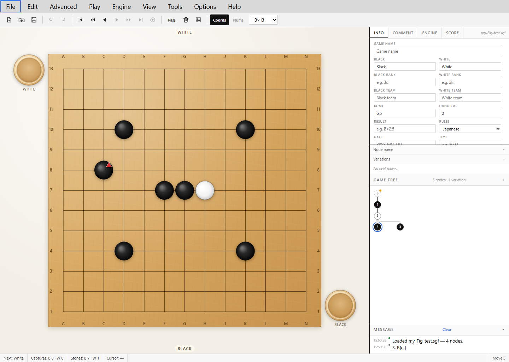
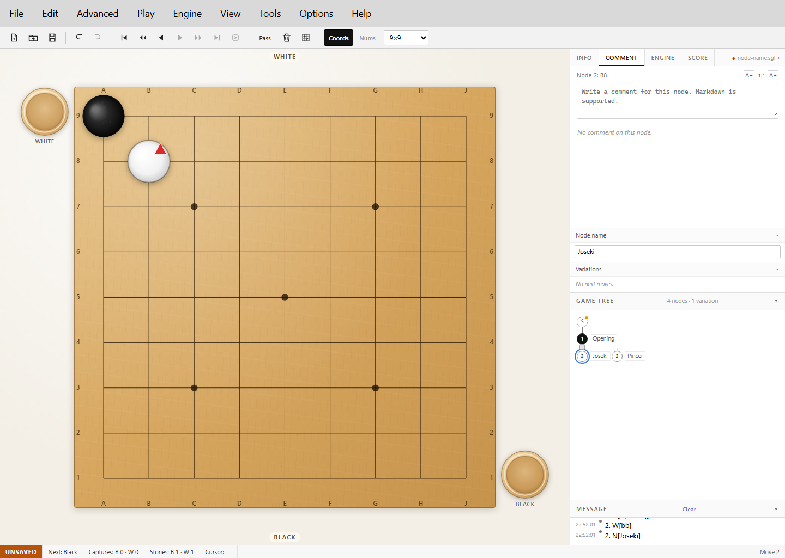
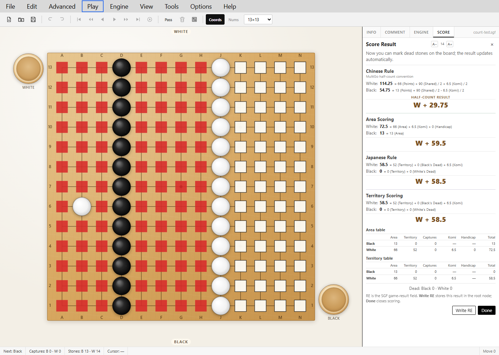
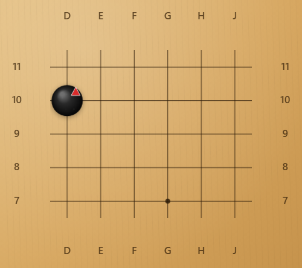

# MultiGo Neo — Beginner Tutorial

**Version 1.1.21 · about 10 minutes · no Go experience required**

This tutorial walks through the most common task: **open a game record, replay it, try a variation, save your work, score it and export a picture**. Follow the steps in order; each one tells you what you should see.

---

## Before you start

Pick the build you have:

| Build | How to start |
|---|---|
| **Installer** | Run `MultiGo-Neo-1.1.11-setup.exe`, then launch **MultiGo Neo** from the Start menu or desktop. |
| **Portable** | Double-click `MultiGo-Neo-1.1.11-portable.exe`. Nothing is installed. |
| **Web / USB** | Unzip the web zip (or copy the `web-portable` folder), then open `index.html` in Chrome or Edge. |

Everything runs **offline** — no account, server or internet connection is needed.

---

## 1. Know the window

Starting from the top:

1. **Menu bar and toolbar** — File, Edit, Play, View… and the board tools. The **Coords** and **Nums** buttons show coordinates and move numbers.
2. **Board** — the goban. Click an empty intersection to play a move.
3. **Game Tree** (right side) — every move is a circle. Branches are variations of the game.
4. **Tabs** — **Info** (players, komi, rules), **Comment** (notes), **Engine**, **Score**.
5. **Message panel** (lower right) — a log of what the app did.

You can drag the dividers between these areas to make the board or panels bigger.

---

## 2. Open a practice game

**With the installer:** choose **File → Open SGF…** (`Ctrl+O`). Go to the folder where MultiGo Neo is installed, open `sgf\十三路打谱操`, and pick a file such as `13x13_Game01.sgf`.

**With the web build:** choose **File → Open SGF…** and open `sgf/十三路打谱操/13x13_Game01.sgf` inside the unzipped folder.

**With the portable exe:** the bundled records travel inside the exe, so simply open any `.sgf` from your PC — or use the web build if you want to browse the sample folder.

**You should see:** the board fills with the first position, the Game Tree has a root and a chain of move nodes, and the title bar shows the file name.

> If the app asks “Keep playing?” after two passes, that is the end-of-game prompt; choose **Keep Playing** for now.

---

## 3. Step through the game

Use the toolbar arrows or the keyboard:

| Key / button | What it does |
|---|---|
| **↓** | Next move (first child of the current node) |
| **↑** | Previous move (parent) |
| **Home** | Jump to the start |
| **End** | Jump to the end of this line |
| **← / →** | Switch between sibling variations at a branch |
| Click a node in the Game Tree | Jump straight to that move |

**Try it:** press `Home`, then `↓` a few times and watch the last-move marker and move numbers. The selected node is highlighted in the tree.

At a branch point the tree splits. Press **←/→** to switch between sibling variations; the board follows the selected branch.

---

## 4. Try your own move — without losing the original game

This is the heart of a study tool: you can explore without destroying the record.

1. Click an **empty intersection** on the board.
2. A new move is appended after the current position. If the current node already had a next move, your move becomes a **new variation** and the tree shows a branch.
3. Made a mistake? Press **`Ctrl+Z`** (or the Undo button).
4. To go back to the original game, click the node **before** your move. Your variation stays in the tree; the main line is unchanged.
5. Use the **`−`/`+`** toggle beside a branch node to collapse or expand it.

> A normal click plays a move. If you want to edit stones or add marks instead, press **`Ctrl+E`** to toggle Edit mode; press it again to return to playing.

---

## 5. Add a short comment (optional)

1. Select a node.
2. Open the **Comment** tab on the right.
3. Type a note in the editor. It is stored in the SGF with that move.
4. Use **A− / A+** in the Comment header to make the text bigger or smaller.
5. You can keep editing while moving through the game: with the cursor still in the comment box, press **Ctrl+Shift+↑ / ↓** to move up and down the **current branch** (previous/next move), and **Ctrl+Shift+← / →** to switch to another branch. The up/down arrows stay on the same branch. The pending comment is committed first and focus stays in the editor, so you can keep typing at the new node without clicking back into the box.

Comments support simple Markdown (bold, italics, lists and links).

---

## 6. Save your work

The status bar shows **UNSAVED** in orange when something has changed.

- **File → Save SGF** (`Ctrl+S`) writes back to the same file.
- **File → Save SGF As…** (`Ctrl+Shift+S`) saves a **copy** — recommended while learning, so the original record stays untouched.

Give the copy a new name such as `my-first-review.sgf` and save it somewhere you can find again.

> In the browser build, Save downloads the file. Use **Save SGF As…** to choose a name.

---

## 7. Score the position

When you want to know who is ahead:

1. Choose **Play → Score** (`Ctrl+Shift+R`). The **Score** tab opens.
2. Click stones that are **dead**; click again to bring them back. Dead stones join the prisoner count.
3. Read the result (for example `W+6.5`) and the totals in the Score tab. The board shades territory and marks dame points.
4. Choose the rules (Japanese or Chinese) in the Score tab.
5. **Write RE** stores the result in the game record; **Done** or `Esc` closes scoring.

**Play → Estimate** (`Ctrl+Shift+E`) is the same panel with sealed dead stones pre-marked — a quick first guess that you can correct by clicking.

---

## 8. Export a picture of the board

1. Choose **File → Save Board as Picture** (`Ctrl+Q`).
2. Drag over the part of the board you want, or leave the whole board selected.
3. Pick **png** or **jpg**, a size, and whether to include coordinates.
4. Click **Save** and choose a folder.

The dialog remembers your last selection and folder next time.

---

## 9. Three useful extras

- **Bigger coordinates:** click a coordinate letter or number (or the margin just outside the stones) to **double** the label size. Click again to restore it. The setting is remembered.
- **Bigger board:** press **`F11`** for full screen, or drag the panel dividers inward.
- **Another window:** choose **File → New Window** (`Ctrl+Shift+N`) to open a second independent window; in the browser it opens a new tab.

---

## Quick reference

| Task | Shortcut / menu |
|---|---|
| New game | `Ctrl+N` |
| New window | File → New Window (`Ctrl+Shift+N`); new browser tab on the web |
| Open SGF | `Ctrl+O` |
| Save / Save As | `Ctrl+S` / `Ctrl+Shift+S` |
| Navigate while typing a comment | `Ctrl+Shift+↑/↓` previous/next move in the current branch; `Ctrl+Shift+←/→` switch branch |
| Next / previous move | `↓` / `↑` |
| Start / end | `Home` / `End` |
| Sibling variation | `←` / `→` |
| Undo / redo | `Ctrl+Z` / `Ctrl+Shift+Z` |
| Pass | `P` |
| Edit mode | `Ctrl+E` |
| Score / Estimate | `Ctrl+Shift+R` / `Ctrl+Shift+E` |
| Export picture | `Ctrl+Q` |
| Full screen | `F11` |

---

## If something looks odd

| Problem | What to do |
|---|---|
| The board is very small and panels are huge | Narrow the window to use the portrait layout, or drag the dividers; **View → Responsive Layout** controls this. |
| Bowls are missing | They appear for Japanese rules during play and are hidden in Chinese rules or very narrow panes. |
| The Engine tab is empty | GTP engines are external: install GNU Go or KataGo, then use **Engine → Manage Engines…**. |
| I installed a new version | The installer upgrades the existing app and keeps your settings; it does not keep the old version installed. Use the portable build or web folder to keep two versions side by side. |
| The web build still looks old | Press **Ctrl+F5** once to reload without the browser cache. |
| Coordinates are too small | Click the coordinate labels to double them (step 9). |

---

## Where to go next

These three documents are also copied into the install folder and the web folder, so they are available offline.

- [README.md](README.md) — the full manual, menus, shortcuts and SGF support.
- [Features.md](Features.md) — the complete feature register.
- `sgf\十三路打谱操` — 17 13×13 study records bundled with the installer and web build.
